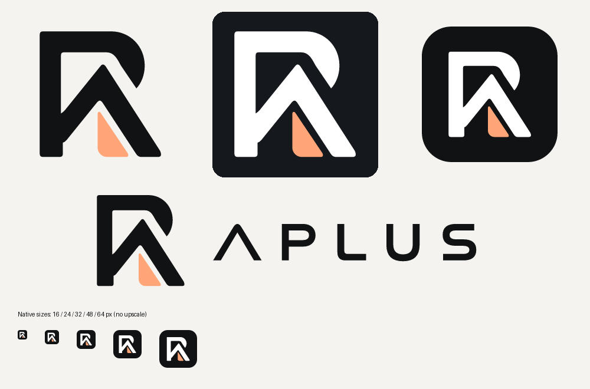

# APLUS 品牌标识规范

状态：已选款式的资产制作与接入方案，**未接入生产、未合并、未发布**。需求来自2026-11-01用户Logo交接；核对最新远端main为`a75ba840bc9df91e76fa168aa44651a0fee18ab6`，与交接评估一致。开工活动PR为空。独立于Issue92图表研究和发布修复。

## 已定方向与本轮资产

保留PA组合、黑白主体、杏橙内形与APLUS字标，不重新设计方向。见[用户确认参考](images/aplus-brand-reference-confirmed.png)及[较高分辨率原稿](images/aplus-brand-reference-original.png)。它们是参考展示板，不是图标出口。

唯一几何源为[master.svg](../assets/brand/master.svg)。PA轮廓和字标均手工重建为可维护路径；未使用自动描摹噪点、内嵌位图、外链字体或底部缩略图放大。参考图存在纹理和阴影，本轮扁平化不复制材质。APLUS字标来自参考字形的人工轮廓，没有将近似系统字体冒称原字体。

| 角色 | 本轮校准值 | 用途 |
|---|---|---|
| 主体近黑 | `#111214` | 浅底品牌符号、字标及应用容器 |
| 反白 | `#FFFFFF` | 深底品牌符号和字标 |
| 杏橙 | `#FFA578` | PA内部点缀 |

这些是本次资产重建的精确平面值，待人工审阅，不是交接原图已有批准HEX。品牌色不替换白涨蓝跌、橙色EMA、Entry青绿、SL红、TP沙金或结构灰白；PA图形不是新的策略标记。

导出集合、主稿/出口哈希及工具版本见[资产清单](../assets/brand/manifest.json)，使用形式见[资产README](../assets/brand/README.md)。图形安全区以导出viewBox保留；不压扁拉伸，不在16/24px托盘中塞字标或长文案。小尺寸本轮使用同一几何，无另藏的光学校准稿；如实机16px不足，后续在保持同形和记录规则的前提下校准。

定位文案“A股 · 阿尔布鲁克斯价格行为学 / Al Brooks Price Action”只用于帮助/关于或足够宽的品牌组合。APLUS是主品牌；操盘台、PA成长空间、图表工作区保留业务模块名；技术名Aplus及现有文件路径保留。

## 最新main接入核对与下一阶段范围

交接列出的入口在本次main仍成立；以下是实施计划，**没有改动这些生产文件**。

| 接入层 | 当前真实入口 | 后续最小接入与验收 |
|---|---|---|
| 主窗/子窗/托盘 | `gui/main_window.py`仍为Brooks-AI标题，托盘读根`icon_aplus.ico` | 无Store依赖的共享资源入口，根/独立Tk窗设置图标；按业务名保留弹窗标题，托盘tooltip可为APLUS操盘台 |
| 欢迎/恢复/接续 | `workbench/installed_runtime.py::setup_window`、`installed_bridge.py` | 保留PR91初始化DPI顺序，仅加小图标；不改数据选择、备份、迁移、锁和恢复事务 |
| 图表WebView | `gui/chart_shell.py::_materialize_page`复制明确文件清单，JS/CSS内容指纹 | 带齐同源品牌图像并纳入缓存失效；按背景选反白符号。与Issue92共享外壳接口协调，不并行重写同一容器 |
| DOM/快照/剪贴板 | 原型HTML两处A+，回放另有状态水印；`cleanSnapshotCanvas`合成画布 | 一份已解码品牌源在DOM及导出各绘制一次；Logo失败不阻断保存；保留来源、复权、截止日期、回放状态 |
| 静态兼容图 | `gui/chart_renderer.py`、`chart_workspace.py::_snapshot` | renderer一次绘入，快照不叠第二次；不改坐标、指标、价位或策略标注 |
| PA成长空间 | `gui/pa_growth/index.html`侧栏A、`growth_shell.py`独立加载 | 带齐独立资源路径与窗口图标，保留业务名称、布局、案例图片和隐私文案 |
| 源码Web | `app.py`的Streamlit标题/favicon/侧栏旧标识 | 更新可见品牌资源，保留兼容入口/端口；安装包仍不打包Streamlit |
| 安装产物 | `Aplus.spec/Bridge.spec/Aplus.iss`和`build_installer.py`读根ICO；Launcher内嵌ICO | 根ICO作为同源生成出口，重建主EXE/Bridge/稳定Launcher/Setup；不改GUID、EXE名、Mutex、安装目录、数据目录、快捷方式目标或发布身份 |

接入建议一个独立视觉实现PR：共享轻量资源模块＋上述适用展示入口＋打包资源＋定向证据。**本资产PR不表示已授权重写更新器或修改正式交易数据。**不全仓替换历史文档/截图，不新增启动动画、不清理Windows全局图标缓存、不改变固定任务栏分组；升级后的旧固定图标单独验收。

## 验收与发布边界

本轮已做：两份参考图及三份交接文档完整阅读、最新main/活动PR核对、入口定向源码复核；矢量有效性、外部资源/字体检查、透明通道、PNG尺寸、ICO七帧、清单哈希和重复导出一致性检查；人工查看组合预览及实际小尺寸行。验证结果见[独立记录](验收/2026-11-01-APLUS品牌资产制作.md)。没有启动日用软件、读取正式库或安装覆盖。

下一阶段实际接入按R2定向验证；触及发布/数据安全则停止扩围，另按R3授权。优先复用适用证据，不因Logo重复全池回测。必须验证：

- Win10/Win11、100/125/150/200%：主/子窗、托盘、Alt+Tab、任务栏、独立图表、欢迎和恢复窗，保留PR91字体修复。
- 源码/安装版、全新隔离安装/覆盖升级：Setup、Launcher、App、Bridge、快捷方式和卸载项图标均来自同源资产。
- TV单/多图、窄窗、回放、PNG下载、真实图片剪贴板：水印不遮挡价轴/策略S，只有一份，标题来源/时点仍真实；缺失资产降级不阻断业务。
- PA嵌入/独立/对照窗、Streamlit兼容入口；11类绘图、提醒、回放及六策略只读标注不退化。
- 保护文件逐字节一致；正式数据、安装身份和更新门禁不变。精确main验收后正常构建发布，不把改了仓库等同用户已经更新桌面图标。

未完成：人工资产批准、上述生产接入和实机验收、合并、正式构建/发布。此次PR只交付可审阅资产及计划。
