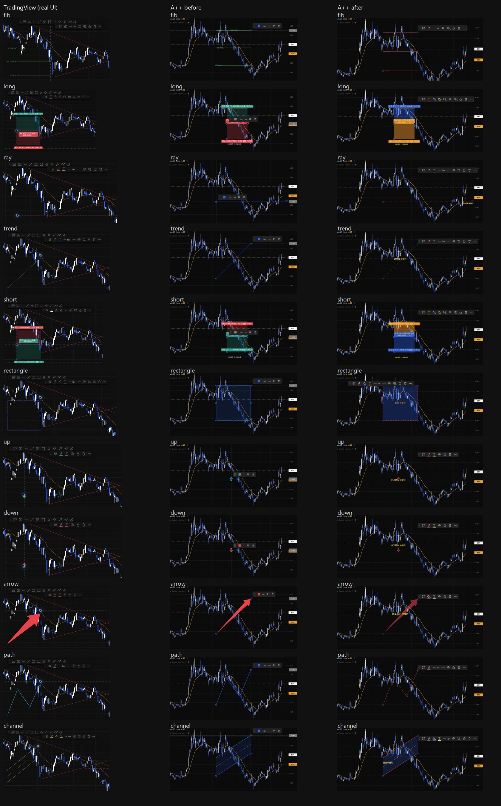
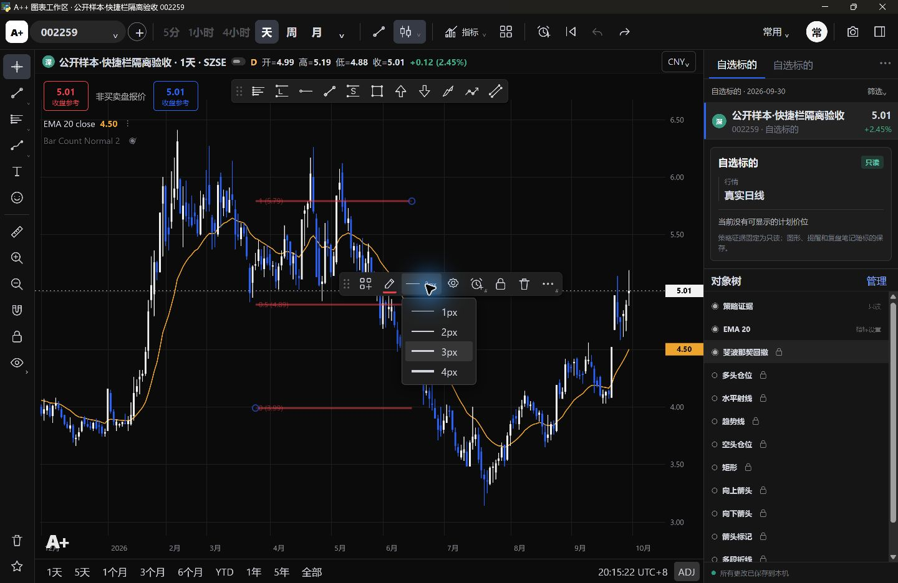
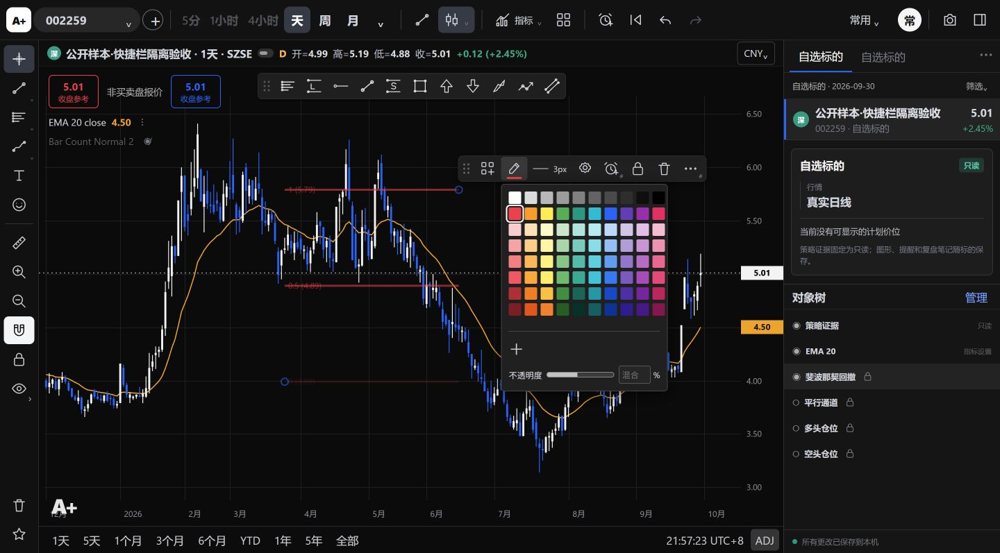

# 11 类绘图专属悬浮快捷栏：对标、实现与验收

日期：2026-10-28（上海）。任务类型：开发及界面验收，风险 R2。基线：`a192515369da647c586a2d7609071cda5bd00d75`；分支：`codex/drawing-quick-toolbars`。本文件记录该分支的实现证据，不代表已经发布、人工批准或完全复刻整个 TradingView。

## 范围与不变契约

目标是让交易员选中现有 11 类图形时，看到对应工具的快捷操作，并立即改变真实图形。复用现有色板、专属属性、撤销栈、模板和 Store 保存链；不新增工具或行情接口，不重构绘图引擎。不修改策略、指标算法、GAP／MTR 标注、周期、对象树、多图布局、数据库结构或交易记录。与 PR77 的策略展示范围独立。

完成标准：11 类均有真实 TV 基准、A++ 修改前后证据；适用控件真实生效并与完整属性同步；持久化及撤销／重做可核验；未实现功能保留 `#`，不能假成功。最终体感仍由交易员人工验收。

## 实际对标方法与环境

- TV：Chrome 中已登录的中文图表，SSE 000001 日线。逐工具真实绘制、观察选中快捷栏，并打开各自适用的颜色／不透明度、粗细、线型等菜单。Fib 与 Channel 另核实全层样式语义。仓位下单按钮只观察，不执行交易；绘图警报未提交。
- A++ 修改前：基线生产静态资源，公开 `sz.002259` BaoStock 前复权样本，在独立测试仓中绘制、选中并截图。
- A++ 修改后：同一公开样本，生产 materialize 资源、真实 ChartBridge 和独立 Store。浏览器验收仅将本机界面请求转交真实 Bridge；不是模拟保存成功。正式运行仓、旧库、用户观察和计划均未读取或写入。
- 11 类操作及重新打开在 Chrome 完成；修改前截图补拍使用同一生产资源的本机浏览器。原生 WebView2 另核验 Fib 保存恢复、快捷改宽、浮栏拖动、端点调整及撤销。没有将浏览器截图称为主窗口嵌入宿主截图。
- TV 临时研究绘图未保存；研究结束恢复自动保存及自选侧栏。截图只保留公开图表及相关工具区域。汇总图为原始截图缩放／裁切拼图，逐项链接保留完整 A++ 截图。



## 逐工具差异与完成状态

下表的“专属段”为真实 TV 快捷栏从左到右的工具控件。公共顺序为：六点抓手 → 模板 → 专属段 → 设置 → 绘图警报（仅适用工具）→ 锁定 → 移除 → 更多。没有把通用线宽强塞给仓位或标记工具。图标采用细描边、颜色下划线及背景桶／T／铅笔区分；悬浮位置沿用可拖动且在绘图区内限位的现有行为。

“完成”仅指该行已支持控件和真实操作，不包含下方明确列出的 `#` 及未验证项目。

| ID／实际工具 | TV 专属段 | 修改前差异及使用影响 | 实现／复用能力 | 状态与证据 |
|---|---|---|---|---|
| `fib` 斐波那契回撤 | 线色、线宽 | 只有通用色块／宽度；层级线及趋势线有独立字段，可能改按钮却不改线 | 复用 24 层与趋势线属性；快捷颜色、透明度、宽度统一到实际字段；独立属性不一致时显示混合值 | 完成；[TV](images/drawing-quick-toolbars/tv-fib.jpg)／[前](images/drawing-quick-toolbars/before-fib.jpg)／[后](images/drawing-quick-toolbars/after-fib.jpg) |
| `long` 多头仓位 | 文字色、盈利背景、止损背景、创建限价单 | 通用色块和线宽不能直接调整两种风险区域 | 复用仓位文字及两区颜色、独立透明度；移除不适用线宽；下单保留 `#` | 完成；[TV](images/drawing-quick-toolbars/tv-long.jpg)／[前](images/drawing-quick-toolbars/before-long.jpg)／[后](images/drawing-quick-toolbars/after-long.jpg) |
| `ray` 水平射线 | 线色、文字色、线宽、线型 | 缺文字／线型快捷入口，颜色图标语义不明 | 复用射线颜色、文字、宽度及虚线字段 | 完成；[TV](images/drawing-quick-toolbars/tv-ray.jpg)／[前](images/drawing-quick-toolbars/before-ray.jpg)／[后](images/drawing-quick-toolbars/after-ray.jpg) |
| `trend` 趋势线 | 线色、文字色、线宽、线型 | 与射线一样套用最简模板 | 复用趋势线真实样式及文本属性 | 完成；[TV](images/drawing-quick-toolbars/tv-trend.jpg)／[前](images/drawing-quick-toolbars/before-trend.jpg)／[后](images/drawing-quick-toolbars/after-trend.jpg) |
| `short` 空头仓位 | 文字色、盈利背景、止损背景、创建限价单 | 无法快捷独立调整盈利／止损区 | 复用空头仓位自己的目标、止损和文字字段，不交换两区含义；下单 `#` | 完成；[TV](images/drawing-quick-toolbars/tv-short.jpg)／[前](images/drawing-quick-toolbars/before-short.jpg)／[后](images/drawing-quick-toolbars/after-short.jpg) |
| `rectangle` 矩形 | 边框色、背景、文字色、线宽、线型 | 背景和文字必须进完整属性，边框／填充不易区分 | 独立边框、填充、文字颜色及透明度；复用原背景开关和线型 | 完成；[TV](images/drawing-quick-toolbars/tv-rectangle.jpg)／[前](images/drawing-quick-toolbars/before-rectangle.jpg)／[后](images/drawing-quick-toolbars/after-rectangle.jpg) |
| `up` 向上箭头 | 图形色、文字色 | 只有通用色块，缺文字入口 | 复用固定大小标记的颜色与文字；颜色面板调图形透明度；无宽度／绘图警报 | 完成；[TV](images/drawing-quick-toolbars/tv-up.jpg)／[前](images/drawing-quick-toolbars/before-up.jpg)／[后](images/drawing-quick-toolbars/after-up.jpg) |
| `down` 向下箭头 | 图形色、文字色 | 同上，缺文字快捷设置 | 同一配置机制读取下箭头自己的对象状态 | 完成；[TV](images/drawing-quick-toolbars/tv-down.jpg)／[前](images/drawing-quick-toolbars/before-down.jpg)／[后](images/drawing-quick-toolbars/after-down.jpg) |
| `arrow` 箭头标记 | 图形背景、文字色 | 色块未表达填充语义，缺文字入口 | 使用背景桶及独立透明度／文字；新标记无宽度，已有旧线箭头仍保留兼容线宽和线型 | 完成；[TV](images/drawing-quick-toolbars/tv-arrow.jpg)／[前](images/drawing-quick-toolbars/before-arrow.jpg)／[后](images/drawing-quick-toolbars/after-arrow.jpg) |
| `path` 路径（多段折线） | 线色、线宽、线型 | 缺线型快捷入口，容易被通用模板误加文本 | 复用路径描边、端点样式和宽度；没有新增文字／警报按钮 | 完成；[TV](images/drawing-quick-toolbars/tv-path.jpg)／[前](images/drawing-quick-toolbars/before-path.jpg)／[后](images/drawing-quick-toolbars/after-path.jpg) |
| `channel` 平行通道 | 线色、背景、文字色、线宽 | 通用色宽可能被各层样式覆盖，填充和文本无法直接控制 | 复用 7 层属性；统一颜色、透明度、宽度，保留各层虚实线；背景及文字独立 | 完成；[TV](images/drawing-quick-toolbars/tv-channel.jpg)／[前](images/drawing-quick-toolbars/before-channel.jpg)／[后](images/drawing-quick-toolbars/after-channel.jpg) |

## 未实现与未验证：不冒充已完成

| 操作 | 所涉工具 | 状态／原因 |
|---|---|---|
| 添加绘图警报 | Fib、多空仓位、射线、趋势线、矩形、通道 | `#`。现有价格／指标提醒不等于任意图形警报；本次没有新增图形触发引擎，不把它偷偷改成价格提醒。 |
| 创建限价单 | 多头、空头仓位 | `#`。没有经授权的经纪商／下单能力；只保留真实参考图标，不连接订单。TV 下单结果也未验证。 |
| 更多 | 全部 11 类 | `#`。TV 子菜单涉及额外对象操作，本次没有伪造菜单或假成功。 |
| 保存模板为… | 全部 11 类的模板菜单 | `#`。A++ 现有状态只支持每类一份本机默认模板，没有命名模板目录。本机默认保存／应用是真功能，明确标注本机。 |
| 其他账户等级、主题、显示缩放及跨日使用 | 全部 | 未验证。真实 TV 基准限本次可访问账户；没有宣称各账号版本、所有 Windows DPI 或长期使用均一致。 |

`#` 字号 9px、低对比灰色、无彩色框，位于按钮边角；悬停提示“功能暂未实现”。点击不会打开无意义弹窗、写提醒或发订单。尚未保存本机默认模板时，“应用”正常禁用，不标记为未实现。Fib／Channel 独立属性混合显示不是禁用。

## 真实设置与状态同步验证

| 工具 | 本次实际操作 |
|---|---|
| Fib | 快捷红色到全部 24 层；3px／4px 到水平线及趋势线字段；完整属性单层改蓝后快捷显示混合，再统一红；快捷不透明度 55%，完整水平位色板读取 55%；完整属性改 2px 后取消恢复原 4px；快捷改宽撤销为 3px、重做为 4px。最后保存为红色 3px、55%。 |
| 多头／空头 | 分别设置黄色文字 85%、蓝色盈利背景 35%、橙色止损背景 45%；完整属性读取同值；实际区域改变；分别撤销／重做。没有修改开仓、止损、目标价或仓位计算公式。 |
| 射线／趋势线 | 红线 65%、3px、点虚线、黄色文字；完整属性添加对应文字并核对颜色；撤销／重做。 |
| 矩形 | 红框 65%、蓝底 25%、3px、短虚线；完整文本改橙色后快捷文字色同步；撤销／重做。 |
| 上箭头／下箭头／箭头标记 | 红色图形 55%、黄色文字；在各自完整文本页添加文字并核对；没有不适用的线宽；分别撤销／重做。 |
| 路径 | 红线 70%、3px、短虚线，图形真实改变；完整设置无文本页／快捷无文本按钮；撤销／重做。 |
| 通道 | 先在完整属性将中线改橙色 4px，快捷显示混合；再统一红色 3px、60%，7 层均同步，中线虚线仍保留；蓝底 18%、黄色文字独立；自定义色 `#12ab34` 后透明度仍可改至 65%，再恢复红色 60%；完整属性核对 7 个颜色；撤销／重做。 |

11 类均完成绘制、取消选中后重新点选、对应快捷控件、完整属性核对及保存后的再次打开。辅助操作记录见 [ui-actions.json](images/drawing-quick-toolbars/ui-actions.json)，重新打开后的实际 DOM 控件／色值见 [frontend-reopen.json](images/drawing-quick-toolbars/frontend-reopen.json)。后者在原生试改 Fib 4px 后取得，所以 Fib 宽度为 4px；最终恢复为 3px 的实际 Store 记录见 [store-reopen.json](images/drawing-quick-toolbars/store-reopen.json)。这些记录是辅助证据，不能替代人工看图。

公共功能另外核验：保存默认模板 → 改为 4px → 应用默认模板恢复 3px；锁定与解锁；删除与撤销恢复；强制点击 `#` 不弹假对话框。改变对象时关闭原色板，避免将上一对象的设置误写到新对象。

原生 WebView2 复核：正常关闭后重新打开测试 Store，11 类对象仍在；Fib 红色 3px、55% 仍显示；快捷线宽立即改变真实线条，六点抓手可拖动浮栏；拖动 Fib 圆形端点改变结构，撤销恢复，样式保持。最终原生菜单证据如下。主程序内候选／自选等入口及其他 DPI 没有在本任务重新全量验收。



其他直接证据：[TV Fib 全层颜色](images/drawing-quick-toolbars/tv-fib-effects.jpg)、[TV Fib 宽度](images/drawing-quick-toolbars/tv-fib-width.jpg)、[TV 通道全层样式](images/drawing-quick-toolbars/tv-channel-effects.jpg)、[A++ 线宽菜单](images/drawing-quick-toolbars/after-width-menu.jpg)、[A++ 色板](images/drawing-quick-toolbars/after-color-menu.jpg)、[A++ 模板及 #](images/drawing-quick-toolbars/after-template-menu.jpg)。

## 实现与兼容性

- `drawing-quickbar.js`：11 类控件配置、真实样式赋值及统一快捷栏适配；只有对象本身一份状态，没有新增持久化设置模型。
- `drawing-settings.js`：复用通道层级初始化；`chart-palette.js`：色板可接入专属透明度，并与完整属性共享映射。删除不再被调用的旧通用线宽入口，避免继续只写 `object.width`。
- `prototype-interactions.js`：选中时同步专属栏，复用撤销／模板／删除；描边使用独立 `strokeAlpha`。旧全局 alpha 仅在明确修改透明度时拆分，保留原有文字及填充的视觉透明度；只选中或读取不迁移旧文档。
- `prototype.css`／`index.html`：控件样式、菜单及脚本接入；`gui/chart_shell.py`：把新模块纳入现有生产资源复制和内容指纹，不改进程或保存协议。
- 新 `strokeAlpha` 随既有图表文档保存，无 schema 修改。旧版程序不理解该独立字段时可能丢失独立描边透明度显示，未承诺旧版反向还原新样式。

## 定向验证与交付门槛

首次交付定向命令（`1095cfd`）：

```text
python -m pytest -q tests/test_drawing_quickbar.py tests/test_tv_workspace_prototype.py --basetemp .test-toolbar-pytest-20261028-e --tb=short
```

结果：**9 passed，8 warnings，9.21s**。警告来自现有 pandas／NumPy 时间聚合弃用提示。该集合包含 Node 绘图、跨周期及实时专项；本次没有运行无关的完整 pytest。

新增回归把 JS 实际快捷赋值结果交给真实 ChartBridge → Store → 重新 boot，覆盖全部 11 类，核对样式字段和日期／价格不漂移，并确认独立仓 `observations`／`plans` 为空。真实 renderer 断言覆盖 Fib 趋势／水平线的颜色、宽度、透明度，Channel 全层与独立线型，以及其余工具的真实绘制和独立风险填充。另检查生产页面确实携带新模块和内容指纹。

4 个相关 JS 文件语法、44 个证据链接及图片／JSON、Git diff 格式检查通过；相对最新 main，`core/`、`config/`、`frozen_manifest.json`、`workbench/store.py` 无变化，冻结清单 SHA-256 仍为 `721fcd78d9f9d46cf92507e66d35b75385b40c2a8c4b3fcd4e7a4d569762ffcf`。扩大持久化测试时曾因仓位测试样本遗漏端点日期失败，已补齐样本并重跑通过；没有放宽产品校验。初次系统临时目录权限不满足时，改用工作目录内独立测试目录，没有接触使用环境。

代码测试、公开真实行情界面验证、GitHub CI、交易员验收四者分别记录：前两项已完成上述范围；最新提交 GitHub 必需 CI 尚未等待；人工 Review、主窗口体验及长期验收不由本记录代签。PR 保持草稿，待人工明确批准，由有权限者合并；不自动合并。

## 遗留事项（不扩展本次研发）

1. 上表 `#` 的真实后端／命名模板／更多菜单功能。
2. 全账号等级、全部主题与显示缩放、极窄嵌入格、长时间及跨日实际操作。
3. 本机默认模板和 TV 命名／云端模板的产品差异；没有把二者称为完全相同。
4. 原有完整弹窗中不属于快捷栏的其他差异，及其他图表入口问题；保持后续独立处理。

## 评审补充：旧仓位文字与混合透明度

基于 `ef5963e` 复核用户提供的 P2／P3 意见，仍在原 PR79 分支处理，范围只涉及透明度显示与直接回归。

**P2：当前真实调用链未复现，不按错误调用关系改动仓位文字。** 评审引用 `drawing-settings.js::drawAttachedText()` 的 `(textAlpha ?? 1) * (alpha ?? 1)`，但 `prototype-interactions.js::drawUserObject()` 只对趋势线、射线、通道、矩形、路径、箭头及上下箭头调用该函数；多空仓位调用的是 `drawPositionStats()`，其标签透明度直接使用 `textAlpha ?? 1`。因此 `alphaFor()` 对仓位文字保留不乘全局 alpha 的分支，与实际标签渲染一致。本轮只补解释注释，不改变仓位渲染、统计、文字或价格语义。

新增 **24 组实际 renderer 回归**：long／short × target／stop × 全局 alpha 为 0／0.4／0.8 × 无 textAlpha／textAlpha=0.6。逐条比较修改前后所有实际绘出文字及其 alpha，包括统计标签和分析提示，均保持一致；同时检查只有目标区域透明度改变、另一风险区和几何不变。对象带有 `text` 字段时仍验证不走附加文字分支。迁移后的真实对象也进入已有 Bridge→Store→重开测试，防止只检查内存值。

Chrome 生产共享页面额外验证旧对象（alpha=0.4，无 textAlpha）：多头修改盈利区、空头修改止损区前后，文字色板均为原有 100%，统计文字外观保持；[多头修改前](images/drawing-quick-toolbars/review-long-alpha-before.jpg)／[修改后](images/drawing-quick-toolbars/review-long-alpha-after.jpg)。这里 100% 是统计标签原有真实值，不是混合透明度的默认值。

**P3：确认并修复。** 移除快捷栏传递透明度时的 `null → 1` 兜底；色板区分“未提供覆盖值”和“多个层级混合”。混合时数值框留空并显示“混合”，滑块隐藏数值指示点并向辅助功能报告“混合不透明度”；只有明确输入／拖动后才统一。没有在打开时改动图形或保存数据，0% 仍正常显示 0，不误作混合。

真实快捷栏点击适配器与真实色板联动回归：打开不写入；只改颜色保留分层 alpha；输入 100% 后统一并正常重开；输入 0% 后重开仍为 0。该测试在修复前确实以 `100 !== ''` 失败，修复后通过。Chrome 另核实 Fib 只改颜色后仍为混合、明确输入后重开为 65%，通道重开 0% 正确。



[通道混合透明度实图](images/drawing-quick-toolbars/review-channel-mixed.jpg)。本轮仍只使用公开行情与新建的独立 `opacity-review` 测试 Store，没有访问正式运行仓；没有重新修改 TV 页面或扩大功能。

专项命令：

```text
python -m pytest -q tests/test_drawing_quickbar.py tests/test_tv_workspace_prototype.py tests/test_chart_embedded_workflow.py::test_slot_asset_urls_change_with_content_but_not_symbol --basetemp .test-pr79-opacity-20261028-a --tb=short
```

结果：**12 passed / 14 warnings / 6.43s**（既有 pandas／NumPy 弃用提示）；涵盖工具真实绘制、样式重开、跨周期、实时及此前缓存修复，不运行完整 pytest。代码测试与上述 Chrome 专项实操已完成；本轮未重新做原生窗口、其他 DPI 或跨日验收，不等待新 head CI、不自动合并。

## 2026-10-29 复审：透明度输入只提交一次编辑

基于 `8709d91` 核实本轮 P2 成立：原数值框 input／change 每次有效输入都会记历史并保存，“6→65”会拆成两个撤销步骤。本轮仍在原 PR79 分支修复，不修改策略、风险计算、图形几何、行情或 Store 接口。

修复采用临时绘制预览：数字输入／滑块移动只生成当前对象的临时副本，绘图入口读取该副本显示实时效果，正式 `userObjects`、撤销栈及 Store 不接收中间值。Enter、change、失焦或关闭色板时清除预览，并复用原有快捷赋值／完整属性赋值和共享历史，提交一次正式修改。重复 change／blur 不再重复保存；返回原值或以空值／越界值结束不生成撤销步骤。颜色、线型或其他对象操作前结束当前编辑；关闭／切换上下文的保存握手也会先结束当前编辑。没有建立第二份持久化状态或新的撤销系统。

新增回归执行真实快捷栏、真实色板、真实 `rememberObjects()` 及共享撤销／重做处理器，覆盖 Fib、通道、long target、short stop：“6→65”期间正式数据／历史／保存计数不变；提交后各为一次；一次撤销精确恢复原混合／旧样式，一次重做恢复 65%。另覆盖失焦、Enter、显式 flush、滑块、重复结束事件、无净变化／无效输入、同一弹窗连续完成两次编辑，以及完整属性里单独 Fib／通道层级的相同边界。实际 renderer 校验预览确实绘出 65%，不是只改输入框；关闭保存入口的 flush 顺序也有直接回归。

Chrome 生产共享页＋真实 Bridge／独立 Store 实操：

| 阶段 | 实际 Store revision | Fib 24 层的实际 alpha |
|---|---:|---|
| 编辑前 | 2 | 原混合 0.12／0.55 |
| 只输入 6 | 2 | 仍为原混合；画面预览 6% |
| 继续输入 5，成为 65 | 2 | 仍为原混合；画面预览 65% |
| Enter 完成编辑 | 3 | 全部 0.65 |
| 点击一次撤销 | 4 | 精确恢复 0.12／0.55，色板显示混合 |
| 点击一次重做 | 5 | 全部 0.65，色板显示 65% |

[真实 Store 阶段记录](images/drawing-quick-toolbars/review-alpha-gesture.json)。界面截图：[一次撤销恢复混合](images/drawing-quick-toolbars/review-alpha-one-undo.jpg)／[一次重做恢复65%](images/drawing-quick-toolbars/review-alpha-one-redo.jpg)。

额外实操完整属性的通道中线：60%→逐字输入65%→Enter→重开为65%，取消完整属性后恢复60%；输入期间切换另一图形，旧通道正确提交65%，新多头仍保留原 alpha=0.4、没有新增 textAlpha，未串改对象。浏览器错误日志为空。全部操作仅针对新建 `alpha-gesture-review` 隔离仓和公开日线，observations／plans 仍为空；未访问正式运行仓。

定向命令：

```text
python -m pytest -q tests/test_drawing_quickbar.py tests/test_tv_workspace_prototype.py tests/test_chart_embedded_workflow.py::test_slot_asset_urls_change_with_content_but_not_symbol tests/test_chart_embedded_workflow.py::test_switch_reads_document_after_outgoing_flush_not_selection_time tests/test_chart_workspace.py::test_chart_close_waits_for_frontend_ack_and_can_retry_failure --basetemp .test-pr79-alpha-edit-20261029-b --tb=short
```

结果：**14 passed / 18 warnings / 6.36s**，警告为既有 pandas／NumPy 弃用提示。不运行完整 pytest；本轮未重新做原生窗口关闭、其他 DPI 或跨日验收。GitHub 新提交的 CI 不等待，人工批准和人工合并要求不变。
