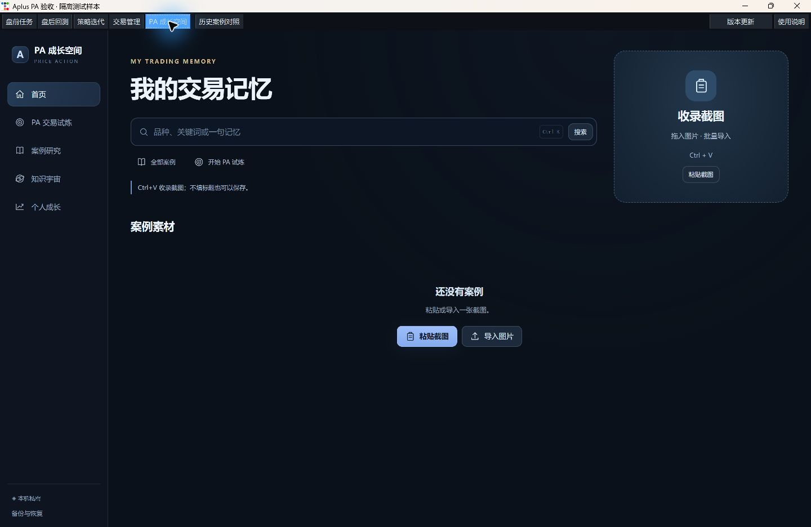
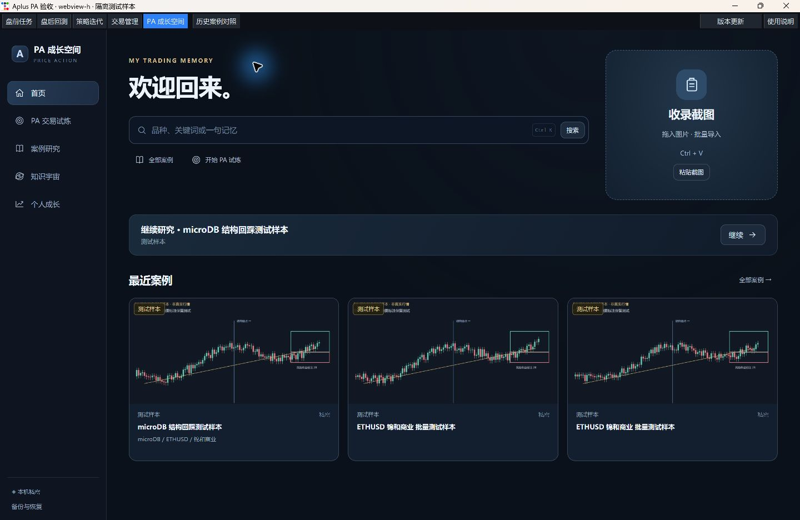
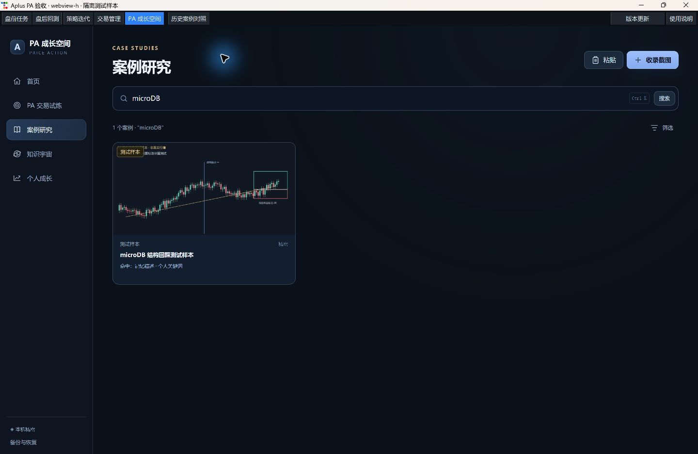
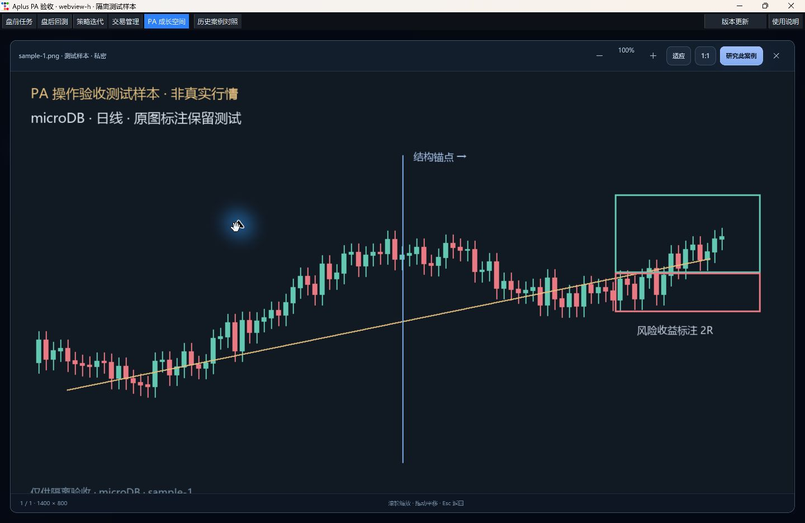
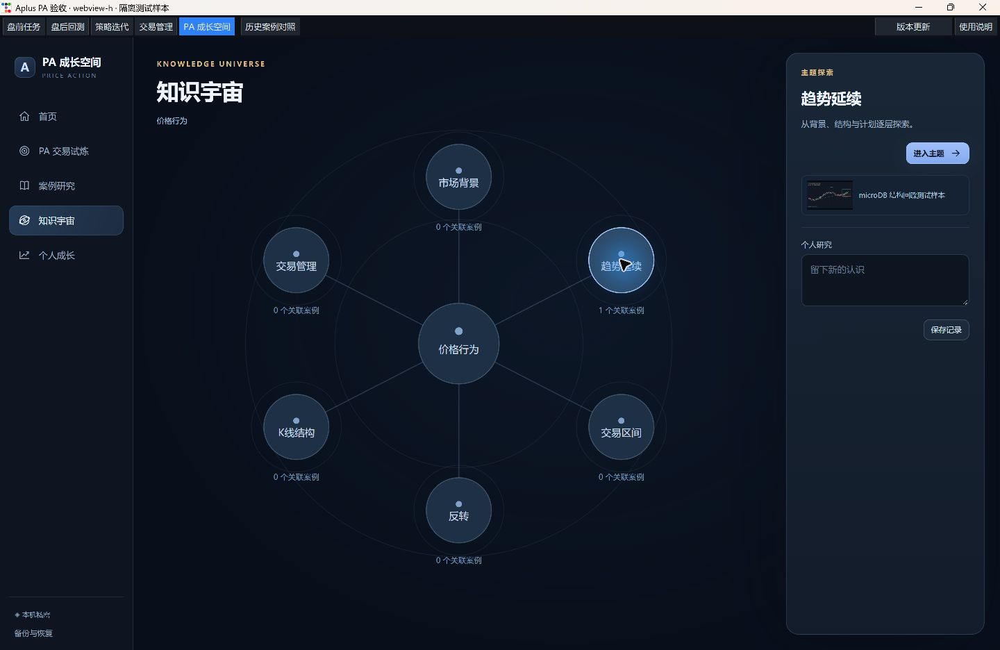
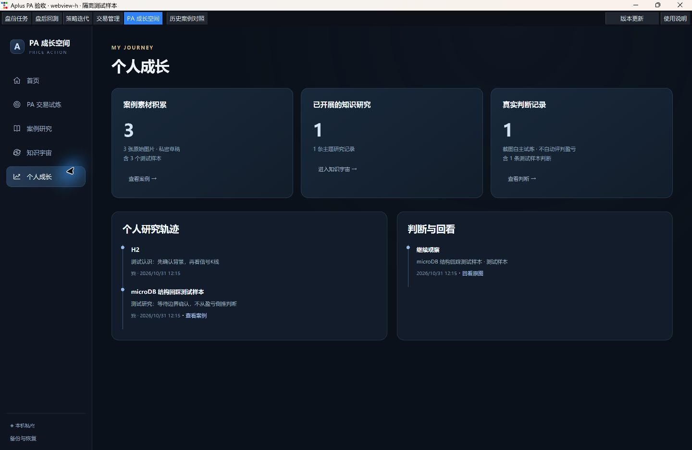
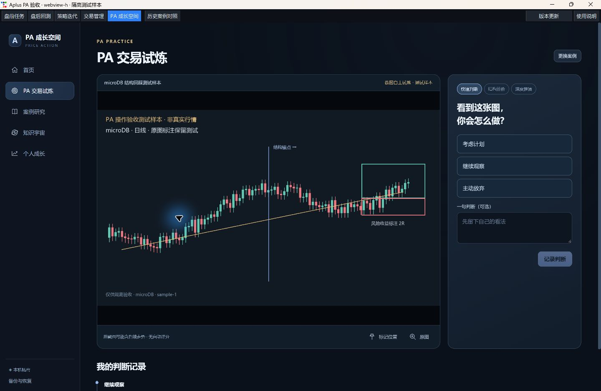

# PA 成长空间 V4.2.1 集成验收（未发布）

2026-10-31，北京时间。任务为正式产品开发，风险等级 **R3**：新增案例数据库结构及安装版数据契约。用户本次任务明确授权案例模型、可恢复迁移和正式入口建设；冻结策略、信号、回测规则和交易账本不在变更范围。

代码基线：GitHub `main` 的 `ec85b8cee32692c18d25f8a309675763140f5169`。产品实现提交：`42f84327a5490967380aae1ba9fa0a2fbdeca1b2`、`21df668f02d482723fea79d200b8a7ce68e7039f`。后续验收提交只补充本记录、运行截图、测试地图及测试图片字体回退，不改变产品行为。

设计依据为用户提供的 `Aplus_PA成长空间_V4.2.1_去说明文字交互原型.html`，SHA-256：`95837f4c97b95031e67b59c314aefbd8f71d58d08633397bc9fc956341667e01`。其中演示案例、随机行情和演示成绩未进入生产数据。

## 本次实际行为

- Aplus 顶栏增加正式入口，使用现有桌面、Store、运行目录及 WebView 子进程能力。原图表继续运行，页面按需加载。
- Ctrl+V、图片拖拽、原生文件选择和批量收录；标题、记忆、关键词均可留空。默认本机私密草稿，每张独立成案，组图与追加图片由用户选择。
- 原图按原字节保存；剪贴板只有位图时无损转为 PNG。文件字节 SHA-256 判重，提醒后允许明确另存，不做视觉判重或自动合并。
- 保存需等待原图落盘和案例事务提交。批次中第二张失败时整批回滚，保留待存图片和文字，不报成功。
- 部分匹配搜索品种、周期、市场、标题、个人关键词、记忆、笔记及手工确认标签；显示命中原因。每批 100 个结果，可继续加载，未命名的旧图也能向后浏览。
- 原图速览、缩放、平移、返回原搜索位置；多图案例、不可覆盖的研究笔记和明确主题关联。
- 当前行情打开案例搜索与独立对照窗，关闭不切换原图表标的、周期、趋势线和视野。
- 再次进入恢复最近研究入口，已有实际记录后不再显示首次收录提示。
- PA 截图自主试炼保留快速判断、结构辨析、深度推演；先记录判断，之后才展开证据／失效条件。可在截图上标记位置，事后研究追加为独立笔记，不改写原判断。
- 知识宇宙按主题逐层进入／返回，关联实际案例；成长页分别汇总实际素材、主题研究和判断记录。测试样本单独标明，不计算掌握度、正确率或收益。
- 本地 ZIP 备份覆盖原图、案例、研究和判断；恢复先校验全部内容，再生成新案例，不覆盖已有资料。

## 原型保留与必要调整

保留深色视觉、首页收录与搜索、案例原图主视图、三种试炼深度、主题关系探索和个人记录。正式导航复用 Aplus 顶栏，成长空间内部采用原型的简洁侧栏，避免改变盘前、盘后、迭代和交易管理流程。

原型的随机教学走势改为用户自己的截图自主练习，明确“原截图可能含后续走势”，没有自动评判或教师答案；尚不具备严格事前数据边界的历史盲测基础设施。团队入口没有认证／同步后端支撑，因此本次不显示发布或团队同步成功，也不制造团队观点。

代码验收中补齐了两处真实使用问题：超过首批结果的未命名案例可继续加载；快速切换知识主题时立即绑定新主题输入框，异步旧回执不能覆盖正在输入的研究文字。

## 交易员操作验收

真实环境为 Windows、项目 Python 3.12.13、Tk、Edge WebView2；全部业务写入均使用隔离目录及明确标识的合成 K 线图片。没有打开用户正式运行库或旧项目数据库。

| 用户验收项 | 实际证据及边界 |
|---|---|
| 首次进入能找到收录入口 | 真实窗口首屏搜索、粘贴、拖入和试炼入口可见，无欢迎弹窗；截图 01 |
| 连续复制多张截图并保存 | Windows 图片剪贴板实际 Ctrl+V 通过；真实 WebView 的多图粘贴事件、拖入及批量保存通过。未实际复制 Discord 私密频道内容，不能宣称 Discord 来源端已验收 |
| 重启仍有图片和备注 | 结束首个 WebView 进程，独立新进程读取同一隔离 Store，原图、笔记和判断仍在；见 `reopened-result.json` |
| microDB／ETHUSD／锦和商业 | 三组关键词及部分匹配经过真实 UI＋Store 检索；图片有“测试样本”标识，并显示真实命中原因；截图 03 |
| 放大、缩小、返回 | 原图字节与导入文件完全一致；UI 缩放与返回保留搜索条件；截图 04 |
| 原行情对照不丢上下文 | 真实 Tk＋三个独立 WebView 进程：原图表 host、PID、token、identity、控制请求及完整已保存图表文档均不变；趋势线、日线及 viewport 保留；见 `comparison-result.json` |
| 同品种多图不自动合并 | 独立批量导入、显式组图、追加和重复确认均有 Store／桥接测试；105 个无标题案例可以分页找全 |
| 私密隔离 | 读、搜、原图及写操作按内部本机身份隔离；伪造其他 owner／不存在案例被拒绝。没有团队服务，未宣称多人账号的端到端权限验证 |
| 保存失败／无结果／重复 | 真实 UI 注入保存失败后保留待存内容；无结果有明确反馈；重复提醒不覆盖原案例，显式同意后可另存 |
| 再次进入不重复欢迎 | 新进程有真实案例后不再显示首次提示，恢复最近研究；截图 02 |
| 无长表单基本判断 | 三个中性行动选项，一句判断可选；提交后才展开证据，记录与事后笔记分离；截图 07 |
| 知识与成长数据不混淆 | 主题回到实际关联案例，研究笔记进入轨迹；素材、研究、判断分开，测试样本注明；截图 05／06 |

复查结果：补充资料默认折叠；保存不要求标题或长复盘；搜索直接看 K 线缩略图；团队发布、自动评分等未实现能力没有伪入口。所有页面数据来自实际 Store 回执，原型没有预置生产案例。

## 代码验证及失败复验

只执行一次完整 R3 本地回归：**2025 passed、26 failed、1 error，1872.33 秒**。完整首轮不能表述为全绿。其失败逐项处理如下，未删测试、放宽断言或更改 CI／分支保护：

| 原失败范围 | 处理与复验结果 |
|---|---|
| 5 项旧 schema 断言 | 更新为本次授权的 schema 9，原数据保留断言仍在；连同发布文档单源检查，**6 passed** |
| 更新日志单源检查 | 移除手写的未发布段，保留从 `release_catalog.json` 生成的日志；本次未发布说明放在本独立记录，不编造 PR 号或发布编号 |
| 11 项安装恢复失败 | 新 Launcher 仍接受 8 导致不一致，改为新版本严格接受 9，旧 EXE 不改；修复合成当前身份声明。关闭／桥接与真实原生恢复专项合计 **50 passed**，包含这些原失败项 |
| 6 项 8.3 路径身份及 2 项环境复用 | D 盘深路径不满足短名／Win32 路径前提。在支持 8.3 的全新短隔离目录复验，相关专项合计 **15 passed**；没有改系统安全设置或放宽产品门禁 |
| 真实 a192 升级及清理错误 | 首轮旧 HEAD 与新 Store 混合，随后确认未知 schema 必须拦截。改为真实 a192 → 精确 schema 8 基线 → 当前 schema 9 的两跳，实际启动确认、备份和旧 facts 保留，**1 passed，263.01 秒**。a192 直接到 9 仍明确拒绝 |

最终 PA 增量验证：Store／桥接／关闭／发行专项 **45 passed**（新增分页前）；最终桥接分页＋Node＋真实 WebView＋独立进程重开 **8 passed，20.34 秒**。真实图表对照 **1 passed，20.32 秒**。新增 Node 延迟回执用例覆盖分页追加失败、重复请求、新关键词覆盖旧请求及主题草稿竞态。

一次额外整模块复验在受限原生环境中未完成，已结束，不计为通过证据；它不替代上表在正确环境完成的针对性复验。定向验证仅在所覆盖代码、数据和环境前提仍有效时复用，没有为每次提交重复完整 pytest。

冻结校验通过，返回 `185541a4c226af123a36d113ca741c1b207a5413cd6fb6b4fd980381f0ff312c`；`core/`、`config/`、`frozen_manifest.json`、依赖锁与 `.github/` 无改动。`git diff --check` 通过。

## 迁移、升级及恢复边界

- schema 9 仅新增 PA 表和版本标记。Store 在迁移写入前创建 SQLite 一致性备份，备份失败则停止；旧交易表和图表文档保留。
- 原图先 fsync／原子写入，再提交案例事务。失败事务可能留下未引用的原图文件，不会出现在搜索结果中，不通过删库或删 runtime 解决问题。
- 原图读取验证大小、SHA 和路径归属。缩略图为可丢弃的本进程缓存；搜索直接由已提交资料重建，不依赖额外索引库。
- ZIP 恢复校验版本、路径、关联、数量、大小和所有原图后再写入；重复恢复会产生副本，现有案例及正式交易数据不覆盖。
- 源码更新保留已有备份／副本迁移及实际启动确认。缺少来源 schema 的早期 a192 须先过已知兼容基线，不能直接推断来源版本。
- 已发行 schema 8 EXE 的跨 schema 自动更新保护继续生效；迁移到新安装版需要单独安排人工安装。新 schema 9 仍只自动接收相同 schema 的包。没有通过错误标记 manifest 为 8 来绕过保护。
- PA ZIP 备份不是交易账本备份。数据库级恢复须先完整退出程序、保留当前库及原图，再由负责人依据一致性备份处理；不能只回退程序或删除运行目录。

未构建或发布本 PR 的新正式安装包；打包资源、源码／EXE 分派、编译后的原生恢复入口及真实源码升级已有本地证据，最终正式包仍须经过既有 main 发布流水线。

## 实际运行截图与回执

所有图片均来自真实运行窗口，图中行情为明确标识的测试样本；没有用户私密案例或正式持仓资料。

机器回执：[真实 UI 与 Store](images/pa-growth/webview-result.json)、[独立新进程重开](images/pa-growth/reopened-result.json)、[原行情对照](images/pa-growth/comparison-result.json)。

## PR 评审修复轮次

本轮依据两条评估意见修复：[使用与性能评估](https://github.com/sysujonathan/Aplus/pull/88#issuecomment-6541653167)、[最近研究与内存评估](https://github.com/sysujonathan/Aplus/pull/88#issuecomment-6541656796)。主体修复提交为 `7b5e04872c093b8ebfd05ebc29b85965155c5738`；交叉检查后补修试炼弹层及图片缓存生命周期，提交为 `1bc650b8e8b88c7c0a86236edb2e76d61a292621`。风险按 **R3** 验证，涉及资料恢复和失败后的原图清理；本轮未再改 schema、通用 Store 事务或更新安全门禁。上文保留首次交付的验收历史，本节记录新的修复及证据。

### 交易员可以感知的修复

- 首页统计与主题复用一次轻量案例查询，不再重复装载全部图片元数据。最近研究独立读取，案例超过首页前 100 条仍能继续打开。
- 打开案例和修改资料只返回元数据，当前选中的原图才读取。多图改用编号切换，速览和研究页复用当前图片，缓存最多 2 张／64 MiB 编码数据；弹层释放背后被遮挡的原图，关闭后恢复当前图片。此上限不是浏览器解码后的总内存上限。读取失败有重试，不为切图装载整组原图。
- 新建或追加时按单案例累计 100 张／128 MiB 核对，检查与写入在同一事务内，两个窗口并发追加也不能绕过。被拒绝时保留待存内容，旧资料不合并、不截断。
- ZIP 恢复逐张分块解压、校验并暂存，全部验证完成后才注册案例，不把整包原图同时留在内存。旧版超过新案例上限的备份仍完整恢复并可查看，只拒绝继续追加；原有全包容量及安全校验保留。
- Windows 剪贴板中的空、损坏或截断 PNG 会回退读取位图；有效 PNG 仍按原字节保留，超大内容在读取前拒绝。
- “历史案例对照”仍从当前行情入口打开，不替换原图表。对照窗口移除重复的“与当前行情对照”按钮；普通成长空间没有可执行对照能力时也不显示此按钮。底层对照动作与“返回行情”分开，前者保留案例在前，后者明确返回行情。
- PA 专用事务失败后，只删除本次新建且能重新确认未被引用、文件身份及内容均未变化的原图；引用查询失败、外层通用事务或进程中断留下的文件继续保留，不做全目录孤儿清扫。提交成功后的回读失败不会删除已保存图片。
- H2 验收工具支持只读检查 schema 9，继续拒绝未知版本；没有放宽源码同版本更新保护。
- 交叉检查发现试炼原图弹层仍可提前翻后续图片，已将弹层和主页面统一为保存判断后才开放后续图；关闭仍保留首图。关闭试炼选择器后，迟到的案例回执也不会重新启动试炼。原截图可能已含后续走势的提示继续保留，不宣称严格盲测。

### 本轮验证证据

- 主体修复后的一次完整 R3 回归：**2096 passed，272 warnings，1694.58 秒**，包括真实 a192 两跳升级、原生更新恢复及图表专项。使用全新短路径隔离目录，未打开用户正式数据库。之后交叉检查补修的前端弹层与缓存生命周期按影响定向复验，没有重复完整 pytest。
- 存储及恢复专项 **29 passed**；新增桥接评审专项 **12 passed**；相邻桥接／关闭／更新专项 **62 项通过**。后者中两项真实原生窗口初次受临时目录环境影响，在隔离的可写 TEMP／TMP 复验通过，没有放宽断言。
- 新增原生对照动作／IPC 与关闭专项 **12 passed**。此项通过测试直接触发对照回调，不能当作正式界面新按钮的真实点击验收；实际入口仍是已有“历史案例对照”。
- 最终真实 Edge WebView＋Store＋独立进程重开 **2 passed，26.47 秒**：导入、粘贴事件、失败保留、判重、三个关键词搜索、原图缩放返回、研究、试炼、主题关联和成长记录均通过；实际点击试炼原图弹层确认判断前不能翻后图，关闭仍是首图，保存判断后可翻图。隔离资料含 **104 个案例／106 张图片**；新进程从首批之外恢复旧案例，只请求一张原图，不重复首次提示。所有图片均明确为测试样本。
- 补修后原行情对照真实专项通过（40.47 秒），包括原图表进程、identity、周期、趋势线、视野和保存文档保留；两个对照动作／IPC 用例及 Node 回归也通过。该轮首次结果为 **4 passed、1 failed**，失败来自新增 UI 验收脚本误用研究页的按钮选择器；定位后改用实际“试炼原图”按钮，仅复验上述 GUI 两项通过，未改产品代码或放宽断言。其余已通过的对照与 IPC 证据继续适用。
- Node 回归覆盖过期图片响应、读取失败重试、两张／64 MiB 编码数据缓存上限、被遮挡原图释放、元数据不夹带原图、试炼主页面和弹层判断前均只读首图、迟到试炼回执及首批之外最近研究。
- 只读交叉复核检查了事务清理、逐图恢复、旧备份及并发追加边界，未发现需要继续修改的问题。

本轮机器回执：[真实 WebView 与 Store](images/pa-growth/review-webview-result.json)、[独立进程恢复旧案例](images/pa-growth/review-reopened-result.json)、[原行情对照](images/pa-growth/review-comparison-result.json)。上方七张截图为首次交付时的真实运行记录；本轮多图切换已改为图片编号。

## 未完成与交付状态

团队认证／共享／同步和其他成员观点、可靠 OCR、文字／形态相似检索、严格事前行情盲测、自动评判均未交付。本次保留真实可用的本机私密闭环，不影响收录、搜索、原图研究和本地备份使用。

**代码测试**如上；**真实数据验证**未使用真实行情或用户正式案例；**GitHub CI**由 PR 后台运行，本地证据不能替代；**长期实际使用验收**尚未进行。真实 Discord 来源端、跨设备团队权限及新正式 EXE 安装包仍待对应环境验收。

PR 提交后代表 Codex 交付完成，不代表 PR 已满足合并条件或已合并。仍须最新必需 CI 全部通过及人工明确批准，由获得授权的人合并；未启用 Auto-merge。
