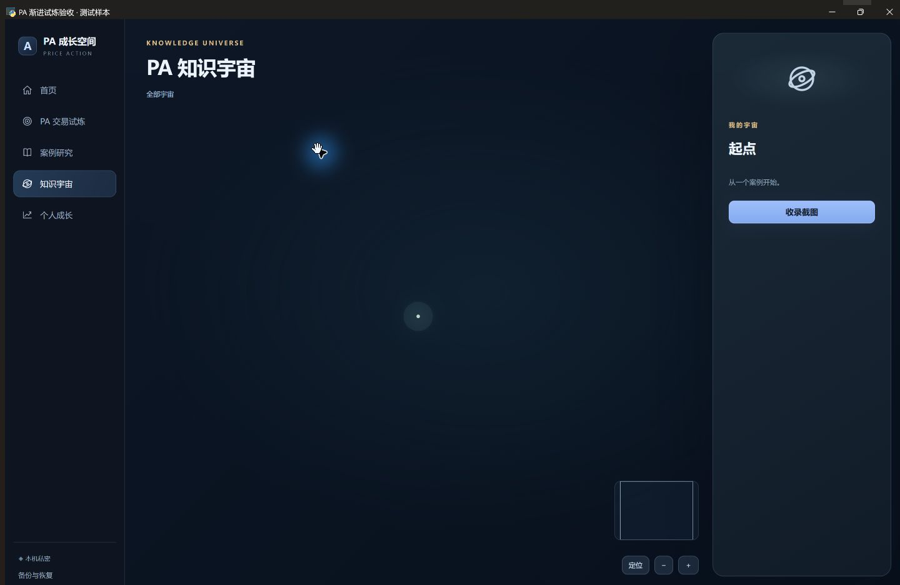
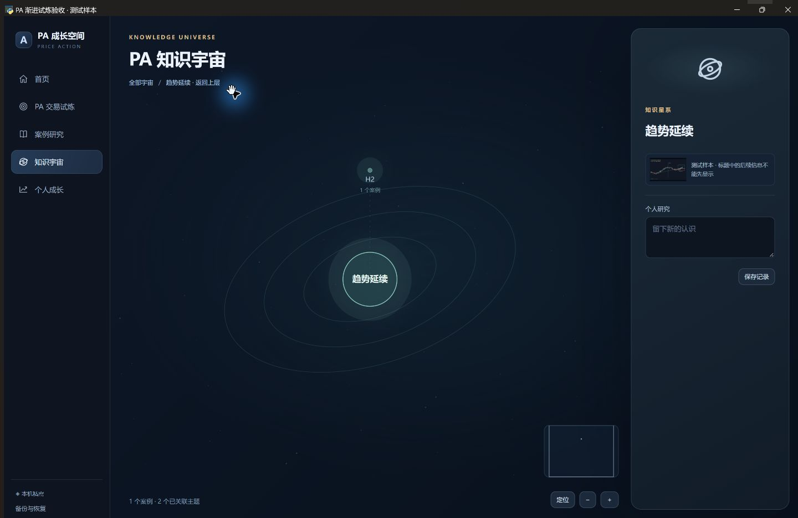
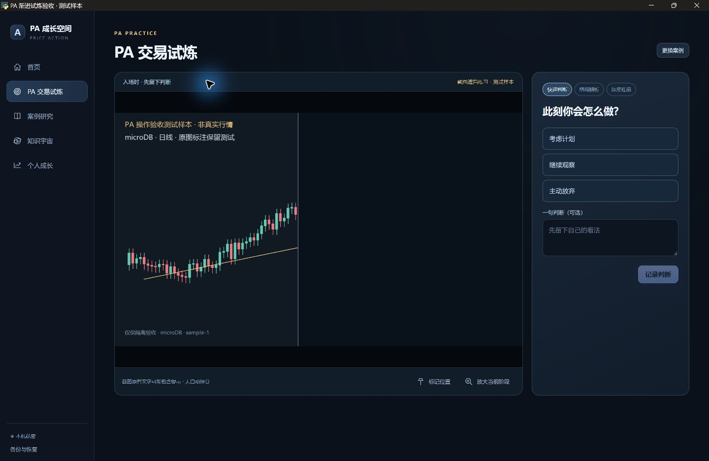
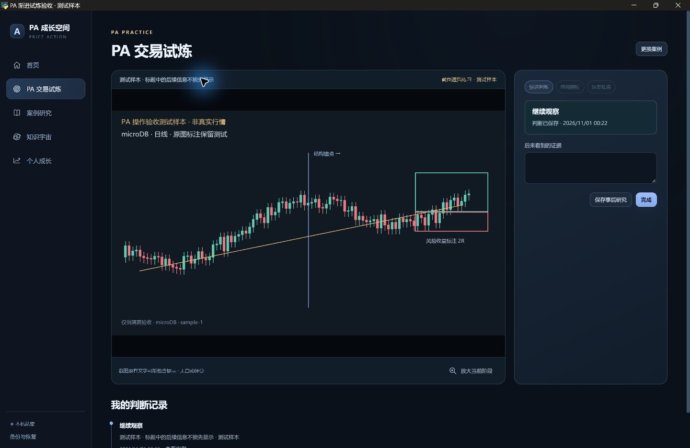
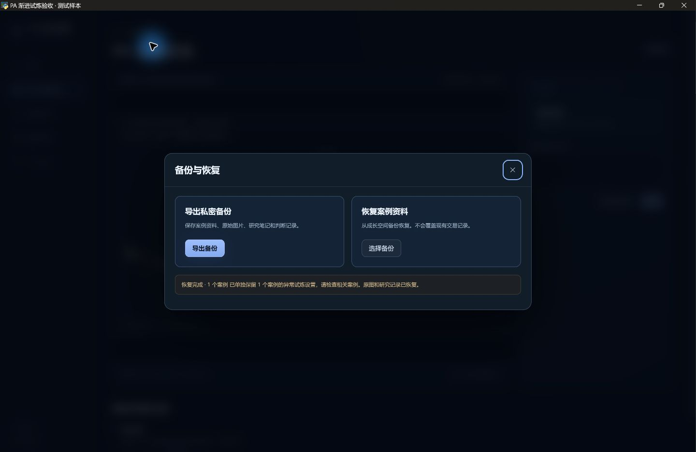

# PA 星图与渐进截图试炼验收

任务类型：产品修正。基线 `main`：`f56160b62055a0c1626ee74dd8f65360d892f217`。产品及测试提交：`519cd0ba14fd23780eda72e53755211516d139fc`。

风险等级 **R2**：仅涉及 PA 私密研究的呈现与可选配置，经现有 Store／meta 持久化。没有数据库版本升级、通用连接／迁移改动、正式交易写入、冻结策略、依赖或更新流程改动。本轮没有操作日常正式版运行库或依赖环境。

## 实际行为及原型对应

- 空宇宙只有起点，未录入案例时不展示预置主题节点。未关联主题的案例生成可打开的独立星点；手工确认关联后，才出现实际主题和祖先星系。标签／关键词没有被擅自当成已确认知识关系。
- 对照 V4.2.1 原型的 `universeHTML`／`initUniverse` 和用户参考图，恢复倾斜椭圆轨道、柔和星核、稀疏星空、侧栏聚焦、拖动／滚轮与按钮缩放、定位、概览、逐层进入和返回。没有照搬演示节点、团队数据、掌握度或设计宣言。
- 案例中增加可选“设置试炼”。多图至少两张，明确选择入场图和后续图片顺序；单图点击图上入场位置或调整分界。收录截图不增加必填项，旧案例不需重导入。
- 未设置的案例进入试炼时先确认设置，不能再把完整后续图直接当作事前画面。新判断前隐藏案例标题／事后备注，只展示当前阶段。
- 单图以原始尺寸比例保存分界，画布只绘制当前范围，右侧像素不画入当前画面。放大遵守同一分界，不通过原图弹层偷看；提交判断不会自动展开，必须明确点击。之后四次逐步展开剩余区域。多图按选定顺序逐张揭示，不从原图弹层跳阶段。
- 判断记录保存当时呈现设置快照；配置已变化时拒绝把旧画面与新设置混在一条记录中。原始图片字节及旧判断不覆盖。
- 新设置保存在既有 meta 中，按本机身份和案例隔离。PA ZIP 备份包含设置，恢复重建图片身份时同步映射设置、判断快照及标记。旧备份无配置仍正常导入；可选配置损坏时仍能查看原图、编辑案例，并提示重新设置。

截图标记只能遮挡图像区域，不能消除原图左侧已画入的事后文字、箭头或价格标注；多图顺序也由用户确认。本次为截图练习，不宣称本地行情回放、严格盲测或自动评判。

## 验证

Windows、Python 3.12.13、真实 Edge WebView，全部使用新建隔离目录及带“测试样本”标识的合成 K 线。未导入用户上传的交易截图到生产或测试仓库。

- 整个 PA 模块 **86 passed，63.88 秒**：含 Store、桥接、保存／判重／检索、关闭、打包分派、原行情对照、Node、新设置和真实 UI。
- 末轮保护与更新兼容专项 **22 passed，7.33 秒**；配置轻量读取及损坏保护再复验 **10 passed，2.08 秒**。这些与 86 项有重叠，不累计为独立测试数。
- Node 生产脚本回归、语法与差异检查通过；相同 schema 的源码更新兼容检查为 `True`。
- 冻结校验：`185541a4c226af123a36d113ca741c1b207a5413cd6fb6b4fd980381f0ff312c`。保护目录、依赖锁及 CI 无差异。
- 本轮按 R2 选择 PA 整模块和相邻契约验证，没有重复全仓 pytest。首次运行遇到受限 TEMP 和过深 Win32 路径后，改用新建短隔离目录复验；测试夹具返回值和 SVG 事件用法错误已纠正，未放宽产品断言。
- 视觉复查发现星核过亮及释放临时图片触发误报，直接修正后重新运行真实像素验收和截图。

## 交易员操作与像素验收

| 操作 | 实际结果 |
|---|---|
| 空资料进入宇宙 | 仅起点；没有主题、案例节点或关系线 |
| 录入未分类案例 | 出现一个实际案例星点，可打开研究 |
| 确认 H2 关联 | 仅出现趋势延续及 H2，可深入、缩放、定位和返回；无资料的交易管理主题不显示 |
| 从主题回到案例设置试炼 | 在真实窗口切换单图模式、调整到 45% 并保存；新 Store 能读取分界 |
| 判断前看图及放大 | 直接读取画布右侧像素，均为遮挡色；标题没有提前出现；无翻图绕过入口 |
| 保存判断 | 分界仍保持 45%，没有自动展开 |
| 逐次揭示 | 四次明确操作后，右侧像素与原图对应像素一致；不再显示无效的下一阶段按钮 |
| 研究记录与原图 | 判断快照与保存时配置一致；三张原图字节均未变 |
| 配置隔离与恢复 | 其他案例／身份图片被拒绝；配置、判断快照随备份重映射并保留原图；不正确配置不覆盖旧设置 |

界面检查：取消／重设有实际效果；无需填长报告；普通收录不强制设置试炼；进入当前星系后不重复显示无效的“深入同一星系”按钮。无新增后台管理页或团队同步入口。

## 实际运行截图

截图来自隔离的真实 WebView 窗口，均为合成样本，没有私密交易记录。

[真实窗口与像素回执](images/pa-progressive/result.json)。

## 边界与交付

### PR90 评审修复：可选设置不破坏备份闭环

依据[评审意见](https://github.com/sysujonathan/Aplus/pull/90#issuecomment-6547233596)，修复提交为 `5f39c71f2740a6a8bf49f061d985255ab1b340f8`。同步主线 `b1a4cf5`，合并提交 `3e5f53c` 保留 PR89 的迟到搜索取消逻辑；系统地图唯一冲突保留双方仍有效说明，没有覆盖已合并的安装接续规则。本轮自身变更仍为 R2，仅处理 PA 资料备份、恢复和反馈；未修改 schema、正式交易写入、发布安全门禁或依赖。

- 导出对有效配置使用与恢复相同的验证并规范化。损坏 JSON／无效分界／非本案例图片关联改为隔离诊断，保留精确原文与原因，源设置不改写；原图、有效笔记及判断仍进入可恢复的备份。
- 恢复只接受合法活动设置和结构合法的只读诊断。诊断按新案例身份存入既有 meta，再次导出仍保留；重新设置不会静默删除诊断。设置需要重设时，案例可查看原图并获得提示。
- 导出和恢复界面均显示高亮告警，不能把“资料已恢复”误认为“异常设置已正常启用”。正常备份继续使用原成功提示。
- 导出前检查恢复端已有的记录数、目录大小及解压容量上限；超限明确失败且不生成最终 ZIP。恢复端的路径、哈希、活动设置、判断及诊断校验没有放宽。

最终 PA 全模块＋新增备份回归＋导航回归：**96 passed，73.66 秒**。包含 9 项新增备份用例：两类评审故障、异案例图片、有效配置规范化、两种篡改备份和三个既有恢复容量边界。重复导出到全新 Store 恢复后，原图字节、研究内容、有效判断及快照关联保持；源异常配置原文未变。Node 验证导出／恢复告警、正常提示恢复，PR89 受控计时器导航回归通过。冻结校验仍为上文值，差异检查通过；未重复全仓测试。

真实 WebView 补充验收中，只替换原生文件选择器以固定隔离路径；页面按钮、桥接、Store、ZIP 导出／恢复均真实执行。无效分界的案例能导出并恢复至新建资料库；界面明确告警，原图及原判断快照保持。[更新的像素与告警回执](images/pa-progressive/review-backup-result.json)。一次可视窗口等待人工截图超时，不计通过；重开后完成最终截图与操作验证。

此修复针对新导出的备份。旧版已生成、包含未经隔离无效活动设置的 ZIP 仍严格拒绝，需要从原资料库重新导出；没有通过删除校验来接收异常活动配置，也没有自动修改历史判断。

真实 UI 操作与代码验证通过；未用真实行情或用户正式案例做训练验证，长期使用验收未完成。新代码经 PR 交付，不直接覆盖正在使用的日常版本；未发布新 EXE。最新必需 CI 与人工明确批准仍须分别完成，不自动合并。
