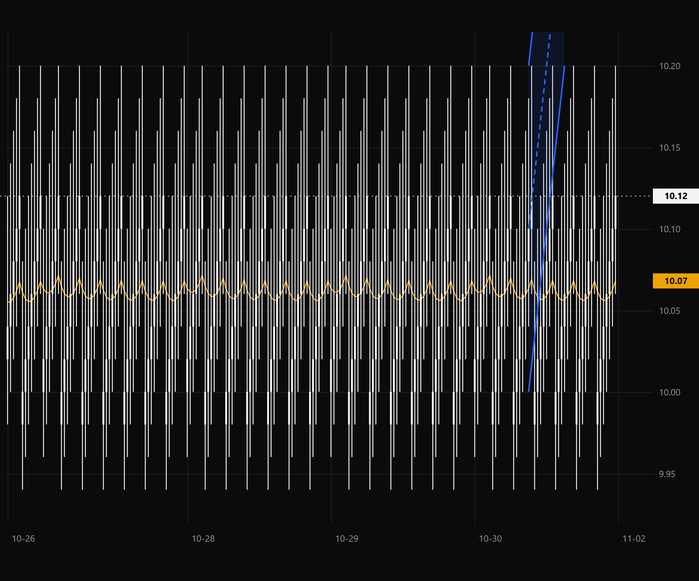
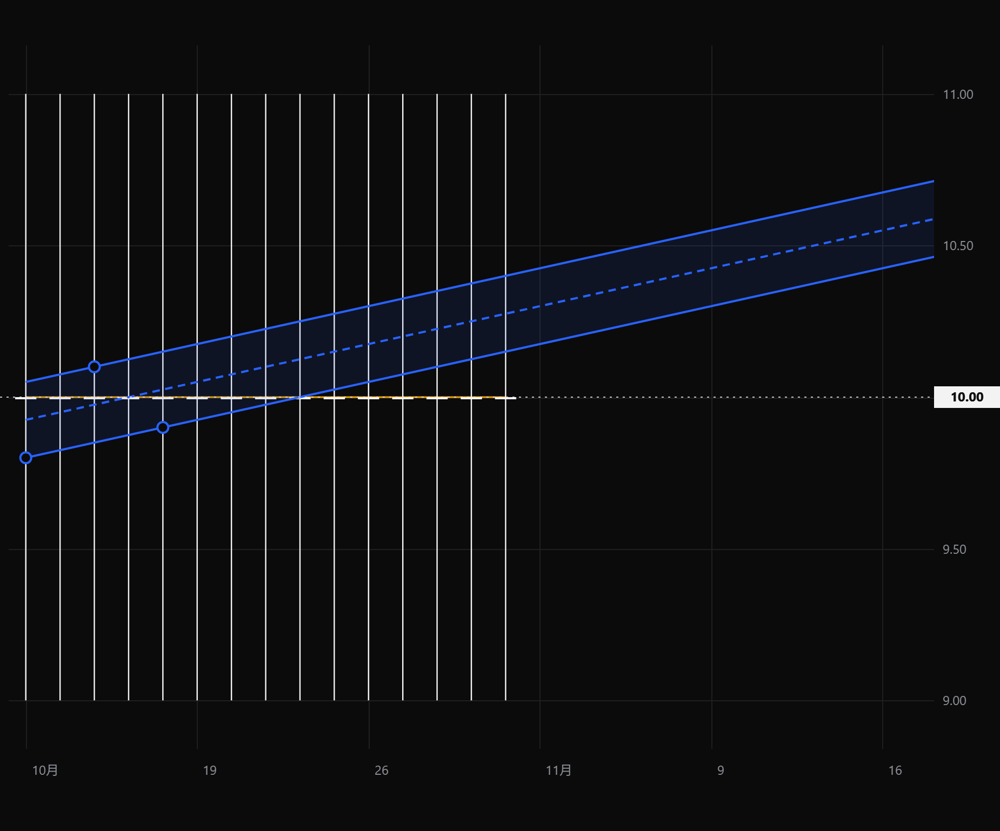
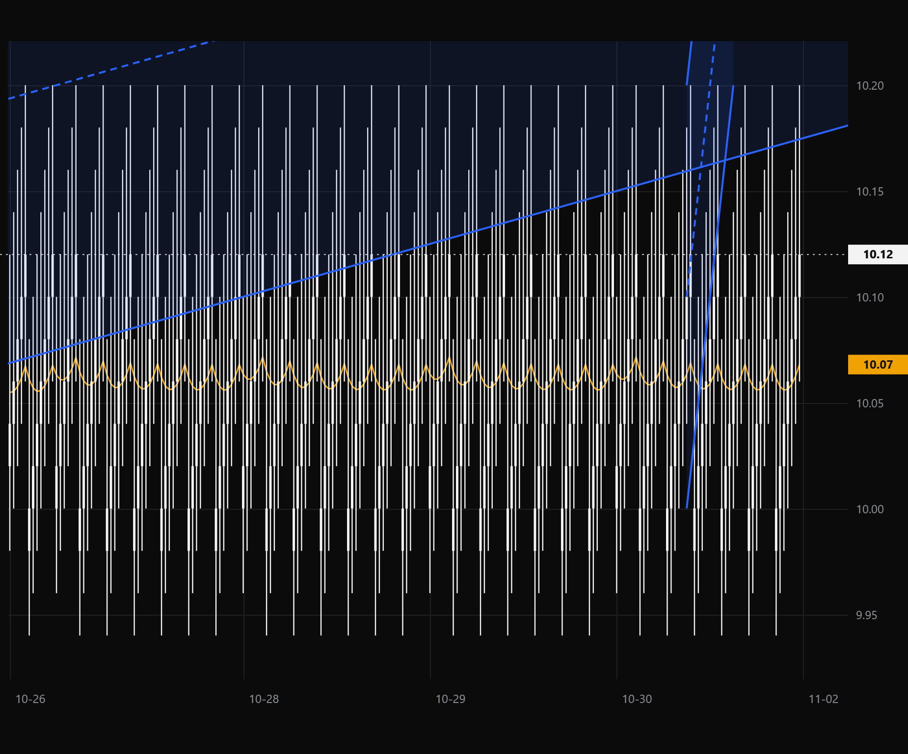

# 分钟绘图与跨周期坐标验收

## 范围与基线

开发修复，R2。基于 main `9f74c295a2ecfb7aefccfe35f68edc03c8ad188f`，分支 `codex/minute-drawing-projection`。
目标是5分钟图能使用现有11类工具，日、周、月、5分钟、1小时、4小时往返保留同一组人工绘图，不改冻结策略、行情计算、Store/schema及正式交易数据。
实现提交与本文一并交付，精确 head 见 PR；实测核心文件 blob：

- `chart-coordinates.js`：`67500e9aa86baf88214e8ea015918e2037ffcf92`
- `prototype-interactions.js`：`80e189661eff21b62d0803afbe5b946a7c5216a1`

## 原因与修复

1. 原 `objectVisibleAtTimeframe` 默认隐藏全部分钟周期人工图形；画出来也立即不可见。取消该隐式禁用，保留主动显隐与Fib可见周期设置。
2. 日线日期不能严格匹配分钟桶，轴外日期又会退回最近可见柱，两个旧端点可能挤在一起。绘图投影改用现有日历、A股午休压缩后的交易时段位置；日线锚点映射当日首根分钟柱，窗口外端点保持不同的轴外索引。只生成少量边界时间字符串，不构造多年分钟行情。
3. 原始日期/时间、价格始终是保存依据，索引只用于当前显示。严格证据匹配 `indexForDate` 保持原行为，不将日线证据伪装为某分钟成交。
4. 行情前缀新增时同步重投影撤销/重做副本。手势或未完成绘图期间缓存新序列，操作完成/取消后应用，即使休市不再轮询也不遗留旧帧；换周期取消未完成草稿。
5. 原保存队列提前捕获旧版本号，真实 WebView 中快速连续绘图触发误冲突。改成发送每个不可变编辑快照前读取上一请求确认的版本号；仍捕获原会话 token，真正多窗口冲突不放宽。
6. 通过已有绘图 `web` 扩展保存创建时复权口径，不增表。跨口径显示提醒且不换算价格；旧对象沿用其文档复权口径。

## TradingView 对照边界

参考官方[跨周期绘图锚点说明](https://www.tradingview.com/support/solutions/43000477901-drawings-are-passing-through-different-points-on-another-interval/)及[可见周期说明](https://www.tradingview.com/support/solutions/43000484410-how-to-set-drawing-visibility-on-different-intervals/)。采用保留时间/价格、按目标周期投影的原则，不承诺高低周期像素完全相同。
本轮未重新操作 TradingView 账户；真实操作证据来自下述 Aplus 生产内核隔离窗口，不把官方说明冒充实测。

## 本地自动验证

环境：Windows 11、Python 3.12.13、Node、WebView2；全部为工作区合成数据。

- `test_intraday_drawings.py`、`test_tv_workspace_prototype.py`、`test_drawing_quickbar.py`、`test_live_minutes.py`、`test_chart_review_round2.py`、`test_chart_review_round3.py`、`test_live_reference.py`、`test_watch_history_refresh.py`：**114 passed / 63.06秒**。
- `test_intraday_drawings.py`、`test_chart_embedded_workflow.py`、`test_chart_workspace.py`、`test_chart_switch_transport.py`、`test_chart_indicator_sources.py`、`test_chart_review85.py`、`test_chart_exit_recovery.py`、`test_closed_chart.py`、`test_chart_evidence.py`、`test_chart_snapshot.py`、`test_chart_annotations.py`、`test_mtr_chart.py`：**201 passed / 82.48秒**。
- `test_holding_quotes.py` 与工具/分钟相邻组合：135 passed；与上述文件有重叠，不相加当作独立用例数。
- 最后去掉非生产演示对象不必要的二次投影后，重跑分钟专项（含真实 WebView 子进程）：**2 passed / 6.77秒**。
- pandas/NumPy 产生现有弃用警告，无失败；未运行完整 pytest。冻结字节检查通过，受保护目录及 Store/sources 无差异。

新增测试直接调用生产放置、投影、切周期和保存函数，覆盖11类工具、六周期往返、分钟精度、午休/周末、窗口外旧通道、价格/日期不改写、其他标的隔离、前缀插入/撤销、草稿期间最后一帧刷新，以及真实 Store 重开。
原生子进程运行完整生产页面、ChartBridge 和 Store，连续快速绘图后实际保存，六周期切换、撤销/重做、重开、复权提示均断言通过。测试调试时修正了合成小时线生成及文件 URL 查询串的夹具错误，没有以删断言掩盖失败。

## 实际操作与图像证据

Computer Use 只定位标题为 `Aplus isolated minute drawing acceptance` 的隔离窗口：选择趋势线、按界面提示点击起点/终点，确认5分钟图出现线条和保存成功提示；点击“天”再点“5分”，原线条及端点仍在。日常安装版、用户数据库与真实画线未操作。

以下为真实 WebView 生产画布三层合成导出，**合成行情、不是交易案例，也不是完整桌面截图**：

最后一图斜率较缓的通道来自日线旧端点，较陡通道在分钟图创建；两者保持各自时间锚点，不互相替代。

## 交易员复验与限制

1. 同一标的日线画通道，开启向右延伸；切5分钟确认支撑/通道仍在，再切小时、周、月，回日线核对端点日期和价格。
2. 5分钟分别画趋势线、矩形、水平射线、Fib、通道、仓位与箭头/路径，编辑、撤销，换周期、换股再回来、正常退出重开；不得丢图或误报保存冲突。
3. 盘中更新和休市最后一帧到达时正在画线/拖动，完成后坐标及行情均正确；缩放/浏览不新增分析修改。
4. 确认只读策略标注、白涨蓝跌、橙色EMA、提醒及回放原边界不变。
5. 若日线前复权而分钟不复权，先核对提示和价格依据，不能把未换算的线当作已经校正的支撑。缩到周/月时分钟端点可能落同柱，回分钟编辑；无分钟数据仍提示不可用，不补造行情。

当前为代码与隔离集成验收；未操作真实行情/用户运行数据，未安装覆盖日用版本，未完成跨交易日持续盘中观察。GitHub CI、人工评审、合并及安装包发布另行确认；提交后不轮询 CI。
