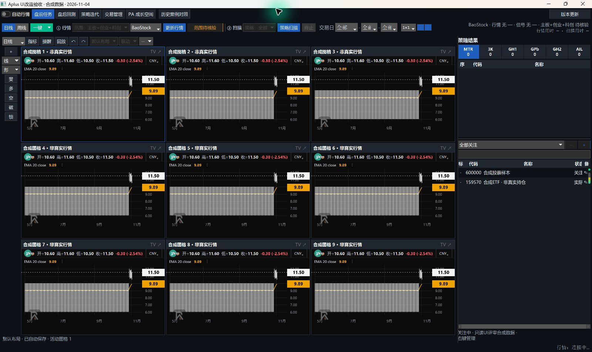
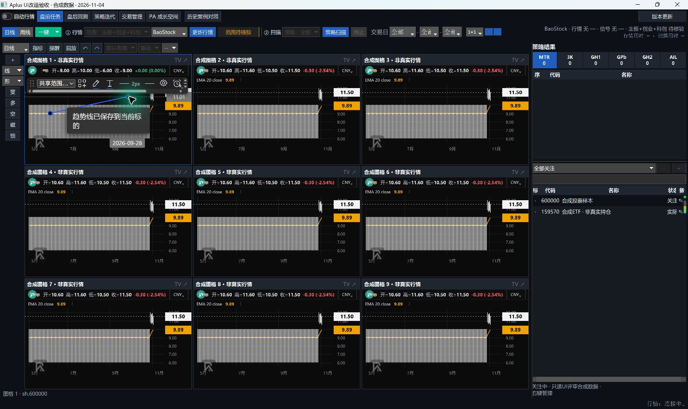
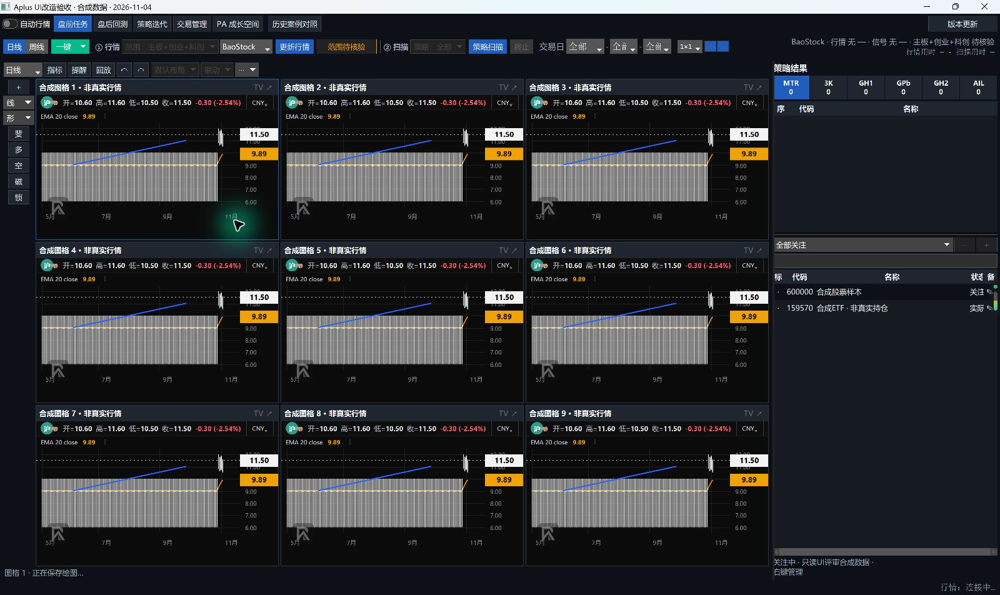
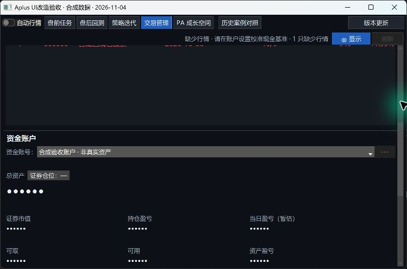
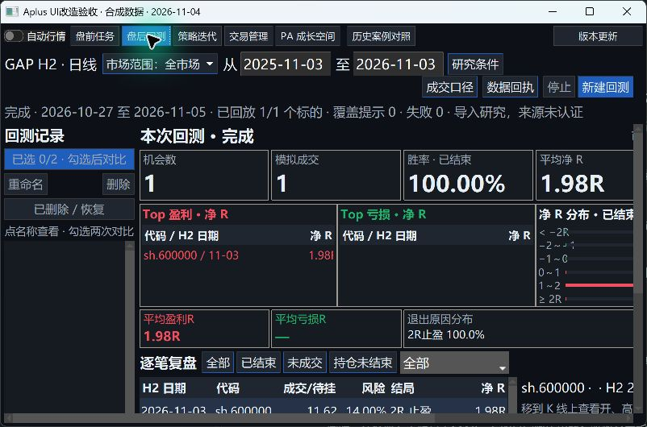
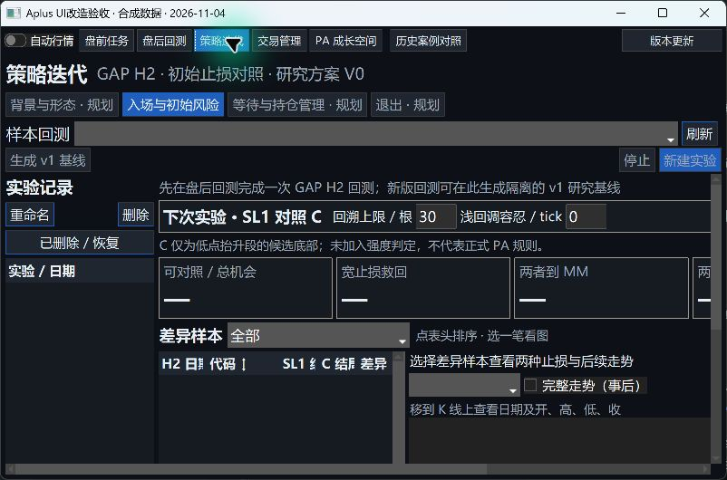

# 工作区与自选表体验优化验收

## 范围、基线与不变项

类型：开发／修复，R2 共享界面、通信和分析配置持久化。基于 main `773b24481db0d881003acc77aa6706488158d21a`（PR102 合并后），分支 `codex/workspace-watchlist-ux`；最终提交号以本 PR head 为准。本次开工查询无活动 PR，独立工作区实施。

收尾时出现 PR104（研究文档）与 Draft PR105（PA 共享知识／身份与私有学习升级）。已定向核对 PR105 差异：本轮不实现其云端、OAuth 或数据模型；共同涉及 `chart_panel.py`、`main_window.py`、`store.py` 及 PA 前端，修改职责不同。后续合并须同时保留 PR105 的 `on_cases` 回调与本轮 workspace 参数／界面偏好接口，不应整文件择一覆盖；无功能前置依赖。

需求为 UI 审计、Issue92 剩余实施及用户附件《TradingView使用说明书》第六章；不把附件中的经纪商交易、社交等说明当新增授权。界面风格参考 Polymarket／Hyperliquid 的低眩光与层次，不改变 A 股业务含义。

未修改冻结策略／参数／清单、行情计算／扫描口径、Store schema、账本计算或发布门禁；未打开／写入正式 runtime、用户数据库、正式安装目录。新增 Store 方法只管理界面配置、分析文档副本和手动关注导入；原记录、备注、策略关联及历史账本保留。

## 审计问题收口

| 原项 | 本轮处理 |
|---|---|
| U01 ETF 显示精度 | 股票两位、基金三位、未知四位、平均成本四位；不对存储价格作舍入 |
| U02 交易页小窗口遮挡 | 移除固定两行高度；窄窗口单列滚动，宽窗口双列；资金与日历可达 |
| U03 DPI 字体混用 | 研究／迭代字体改点尺寸，行高随 DPI；密集内容可滚动，运行／停止留在可见区 |
| U04 多图重复栏 | 一套原生顶／左栏，真实活动格命令路由；九格原生操作有截图 |
| U05 布局与联动模型 | 五项联动、命名布局、绘图三范围、独立偏好、对象冲突／副本；任意分割比例仍未实现 |
| U06 关注信息隐藏 | 状态／备注、可选列、多表、颜色、分组、排序与 CSV；行情来源／时间真实标注 |
| U07 候选仅鼠标 | 使用可聚焦按钮，支持 Enter／Space |
| U08 蓝底文字对比 | 使用更深的主色和中性图格标题；保留活动蓝边 |
| U09 PA 加载被遮 | 加载／错误层置顶至真实 ready；初始容器有非零尺寸，正常切换不卸载原图 |
| U10 无效 AI 热区 | 未实现的开关不再占据顶栏热区 |
| U11 静态／交互蜡烛不一致 | 静态图白涨蓝跌，EMA 橙色；盈亏仍红盈绿亏 |
| U12 层级 | 子图中性标题，活动状态靠蓝边；不把每块内容都作为蓝色主按钮 |
| U13 数字／措辞 | 交易与自选数字右对齐、名称左对齐；清仓修正按钮为“保存更正”，案例周期中文化 |
| U14 品牌 | PA 与图表水印用已批准品牌资源，保留兼容图标入口 |

## 实际证据与复现

环境：Windows 11、Python 3.12、真实 Tk／Edge WebView2；本机 `winfo_fpixels('1i')≈192`，约 200% 缩放。数据是工作区内合成股票／ETF／账户，不是真实行情／持仓。已停止探针的网络行情和自动更新请求。

Computer Use 实际操作：

1. 最大化合成窗口，选择九图；核对顶／左栏各一套，点活动格选择趋势线并落两点。
2. 选中线出现专属快捷栏，默认仅本格；将范围改为当前布局，其他同身份图格出现同一线；点空白隐藏快捷栏。
3. 还原到约 800×530 逻辑像素；打开交易管理，滚动到资金与日历，验证原先重叠内容可访问。
4. 打开盘后研究，确认日期／运行按钮可见，内容通过真实子容器滚动。仅有几何测试不够，实机发现画布覆盖后已修复并重新查看。
5. 正常关闭隔离窗口，执行原退出保存握手，没有强杀用户 Aplus。

截图只表示所述界面交互，不表示真实交易或收益：

## 本地代码验证

- 相邻图表／关注／交易／持仓／研究／PA 模块扩大回归：首轮 **658 passed、1 failed**，失败为 PA 容器映射，保留失败记录；修复后原失败用例 **1 passed**，没有删除断言。
- 新模块专项初轮 **18 passed**；图表／研究／PA 相邻局部批次 **68 passed**，修正真实滚动父子容器后受影响批次 **25 passed**；Store 旧版兼容、流程、原型、分钟行情及打包资源相邻批次 **173 passed**。最终图表／退出／清仓／研究／PA 批次 **75 passed**；补充慢速布局恢复用例后，新模块／嵌入图表／桌面布局批次 **91 passed**（29.32 秒）。这些有重叠，不能相加冒充一次全量通过。
- 最后一批探针曾 **90 passed、1 failed**：另一图格的模拟直接以旧 revision 调 Store 写入，遇到真实并发 CAS 冲突。已改成真实生产 ChartBridge 作为同伴写入者，并保留失败追踪输出；上述最终 91 项通过，没有放宽 Store 或对象冲突保护。
- 真 WebView 探针通过生产 `.commands.json` 切周线／m5，错误 token 不执行；另一格的绘图经 Store 轮询到达，同时保持 m5。历史晚到刷新仍保留分钟周期与视口。
- Node 回归覆盖 11 工具及日／周／月／分钟坐标、行情刷新、查看不写分析、共享范围副本、保存期间拒绝覆盖、同伴绘图不会被本地撤销误删；PA UI 回归保留。
- CSV 导入验证全文件、CAS 冲突和注入中断全回滚；布局复制验证新 ID、全局引用、事务失败无残留副本；独立图表保存不清除隐藏私有对象。
- 慢速分钟行情返回前保存布局，不得把待恢复的 m5／日期范围写成启动日线；恢复以实际命令回执为准，明确人工切周期可取消待恢复设置。
- `git diff --check`、Python 导入／编译及保护文件差异检查。没有为界面改动重复跑完整 pytest，也未轮询 CI。

## 人工复核与明确限制

按[工作区验收清单](../1.1.2多图工作区.md)验证 1/4/6/8/9、日周分钟、五项联动、本图／布局／全局及复制重开；按[自选表说明](../自选表使用说明.md)验证筛选、排序、七色、分组、提醒和导入失败。重点试同对象双窗口冲突、只缩放正常退出，以及来源／复权不兼容时不共享价位。

尚未执行：正式安装包构建／发布、伙伴 Win10 与多种缩放比例实测、盘中跨时段长期运行及九图资源压力。任意分割比例、全表无限实时订阅、分钟比较行情、可信财务／市值／PE／52周／迷你走势不在本轮已实现项；界面明确缺失，不生成示例行情。真实 TV 受限的多图／跨布局行为仍为未验证，不能用本轮 Aplus 结果冒充 TV 证据。

本轮只交付 PR 供人工评审，未合并、未安装到正式目录。GitHub 必需 CI 与人工批准由后续流程判断，不以本地通过替代。

## 补充：交易专用证券名称与基金估值（2026-11-04）

用户明确选择先补名称识别和交易所需行情，保留自选扫描范围；不在本轮新增“全部场内 T+0”扫描分类。与“参考”聊天的 TickFlow 扫描并行任务保持隔离，没有修改扫描服务、并行入口或 TickFlow 下载代码。本补充继续纳入同一 PR。

- 输入有效代码即可先查本地名称，再以一个后台请求补查名称，不必等焦点离开输入框。腾讯返回的外层市场代码、内层代码、重复记录、名称长度及不可见字符均校验；8 秒超时、16 KiB 响应上限，无自动重试风暴。名称不是行情或 T+0 资格证明。
- 手填名称优先；切换代码后的旧结果不覆盖当前标的，关闭窗口取消 UI 回调。未查到或网络不可用时可手工填写，不阻塞交易录入。只有用户确认交易后才沿用原流程保存记录，不因名称查询创建观察／计划／成交。
- 本地某一目录损坏或缺失，不再丢弃其他目录已有名称；已确认持仓、清仓及手动关注的名称可作为目录缺失时的补充。
- 持仓估值现在与盈亏日历一样，可复用已按需取得并通过身份／哈希校验的基金日线缓存，不把基金登记到扫描 datasets。缓存缺失或损坏仍提示缺行情；不将实时快照伪装成历史收盘。原有按需 K 线获取入口保留，其覆盖与成功率仍受提供方约束，本轮没有认证所有 ETF／LOF 的历史接口。
- 当日买入并全部卖出的 T+0 成交，原有实际现金流减税费口径保留，无需无用的收盘行情；隔夜持仓缺少必要收盘仍为未知。

验证：名称／交易专用行情及相邻持仓、日收益、表单批次 **132 passed，82.33 秒**；包括真实 Tk 持仓表单无需 FocusOut 自动填名、后台晚到／人工名称／关闭保护、缓存读取不写数据库、损坏缓存拒收、无行情当日往返和隔夜缺行情。真实只读接口核验 `160723 → 嘉实原油LOF`；未改本机任何交易记录。未重复执行全量 pytest 或轮询 CI。

最终收尾移除了网络线程对 Tk 对象的引用，防止窗口关闭后线程结束时清理界面变量；新增专项复测 **15 passed，3.76 秒**。与前述 132 项有重叠，不累加。
