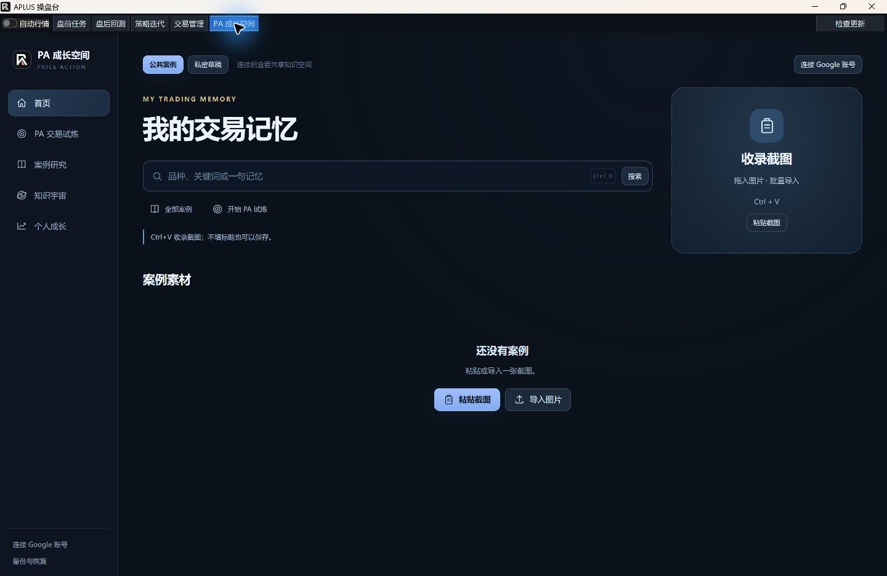
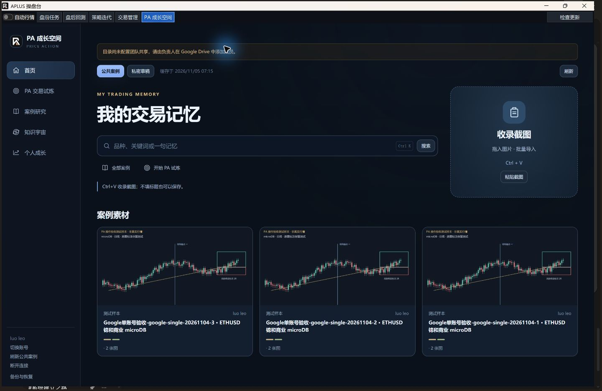
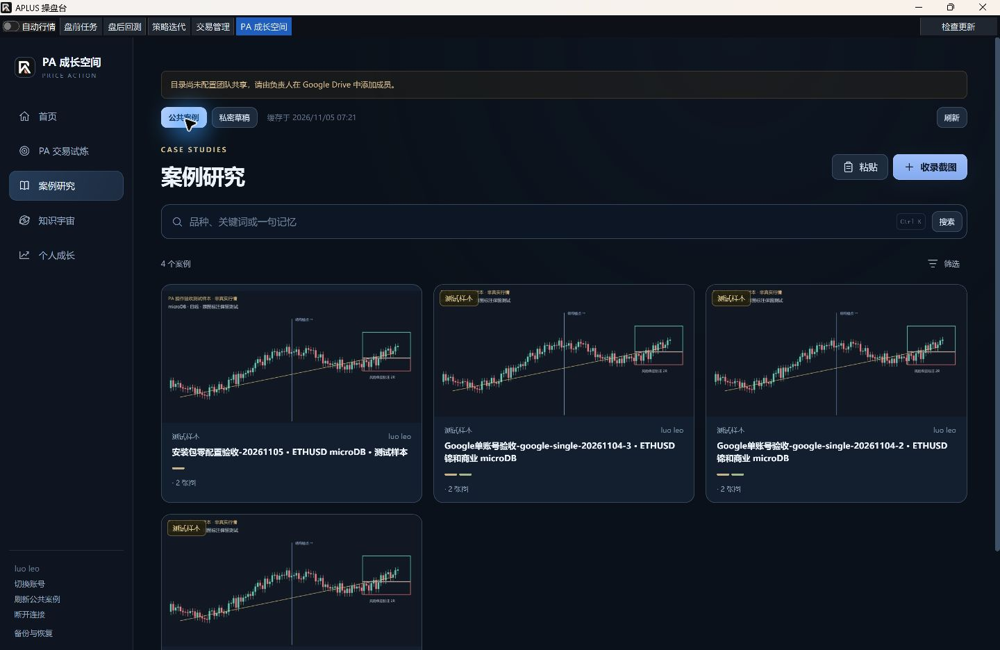
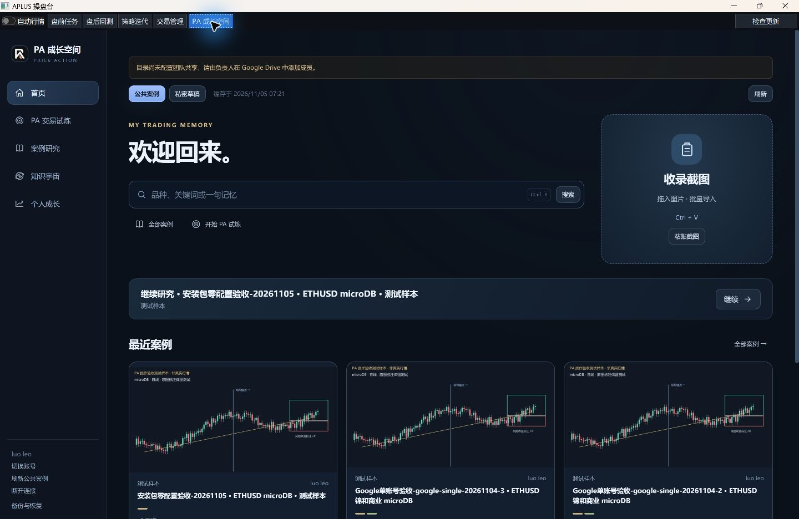
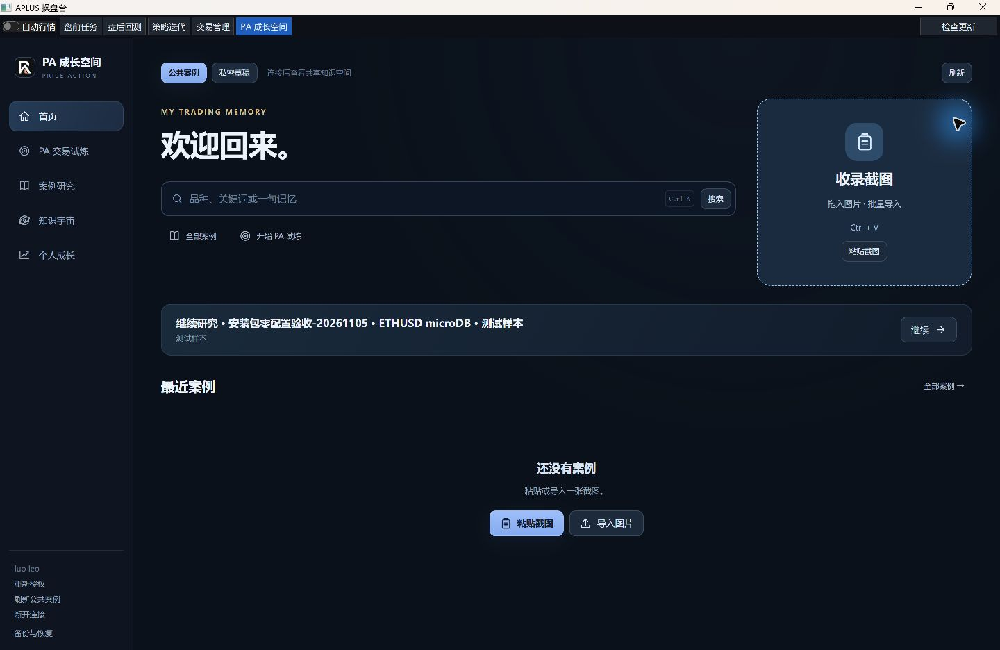
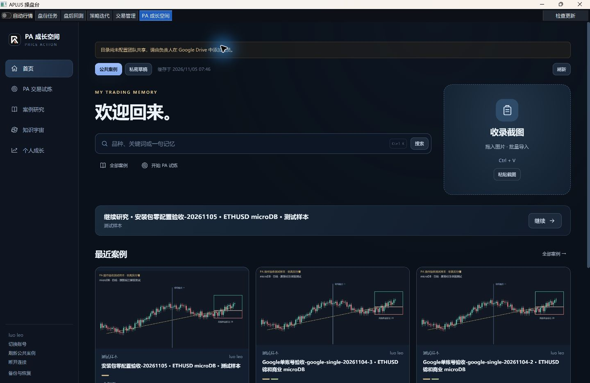

# PA 安装版零配置 Google 登录验收

## 范围和不变契约

R3 安全与发行资源收尾，继续 PR105 原分支 `codex/pa-shared-knowledge`。交易员安装后直接点击“连接 Google 账号”，不再创建或选择 OAuth JSON。唯一公共目录仍为 PA知识库，个人成长跨电脑同步和真实多人验收不在本批范围。

冻结策略、交易规则、Store schema 9、原账本、私密资料、PKCE/state、系统浏览器、DPAPI 用户级存储、跨窗口账号代次及撤权缓存保护不变。不绕过正式 main/CI 发行身份，不自动合并。

内置配置提交 `2766011`，授权等待/重试修复提交 `9f55ecebbfa4c3b06c6f3a44baafbfcf46d29c77`（第三包构建提交）；合入 main `ad35a1cb9d1fa689cac9a7fd200c5253a9115fe2` 后的安装包构建提交为 `d56dda3c3fa7bc12db59d74d2e273aa2ca0348b4`。同步保留主线 PR107 的真实 EXE 扫描子进程构建门禁。

## 实现

- `pa_oauth_config.py` 严格读取包内 Desktop 公共配置；正式冻结版忽略开发环境覆盖并拒绝显式配置路径。源代码开发可独立配置。
- `GrowthBridge.connect_google()` 直接发起 OAuth；成功后激活 PA 窗口并刷新唯一公共库。页面提供连接、切号、断开及失效后的重新授权。
- PyInstaller spec 和构建脚本先校验公共配置，缺损或混入用户材料时停止。真实 payload 再检查用户缓存、令牌 JSON 和私钥头；安装 EXE 自检要求配置存在且有效。
- 资源相对已安装程序定位，不依赖开发机绝对路径，随既有版本目录安装和更新。凭证仍位于安装目录以外的 Windows 用户资料目录。

资源只含 Desktop 公共客户端标识及 Google 命名为 `client_secret` 的公共客户端协议参数，后者不具有后端保密能力。没有 Service Account 私钥或用户登录材料。完整 `drive` scope 仍能管理整个云盘；固定 PA 文件夹只是客户端业务约束，不是 Google 服务端目录权限。内置配置既不缩小权限，也不替代 Google 审核。Google 当前测试发布状态只接受批准的测试账号。

## 构建与代码证据

Windows x64、Python 3.12、锁定 PyInstaller 6.22.3 / hooks 2026.9、经有效 Authenticode 验证的 Inno Setup 7.1.1。三次均走完整既有 `tools/build_installer.py`，不跳冻结、子进程、迁移和接力校验。

| 实际安装包 | SHA-256 |
| --- | --- |
| `AplusSetup-2026.11.05.1-x64.exe` | `a92cfef33f6889384c1cb81c96dab0f736ce84d4f4c46bf4c2bc4f25ac97394a` |
| `AplusSetup-2026.11.05.2-x64.exe` | `913c4e8ee93aa621bdb8ce9d294d7853ac8758b58c427a3f5330d78b57641256` |
| `AplusSetup-2026.11.05.3-x64.exe` | `a34ed40aeb63422db9775dd83983270526b83b6a19be28f99df961f7d2170833` |

三包均明确标识 `preview:true`：使用正式 EXE/Inno 生产打包路径，但 PR 分支不具备精确 main 成功 CI 的正式发布身份。本轮没有发布线上 Release。不得将候选包覆盖安装测试称为正式自动更新通过。

- PA、安装/发行及相邻扫描定向集合：`510 passed, 1 warning / 251.86s`。警告来自 pandas timedelta 弃用，不是失败。
- 新增 OAuth 资源测试修正本机默认 GBK 读取测试文件的问题后，`17 passed / 0.93s`；该项已包含后续 510 项联合结果。
- 新增 401 才显示重新授权、403/404 不误判登录过期、普通离线保留授权的断言：`14 passed / 5.14s`。
- 三次实际 EXE 自检、冻结实际加载器、供应商 IPC、扫描进程 IPC、真实副本 schema 迁移/备份恢复、接力 payload 清单校验及 Inno 编译通过。
- 等待/取消反馈和原账号保留回归，以及原会话/权限/UI 专项：`45 passed / 9.07s`。
- 实际冻结 EXE 的资源移除及损坏两项反向检查均 exit 1，诊断明确为 Google 配置错误；原资源逐字节恢复。没有打开文件选择器或假成功。
- 冻结摘要保持 `185541a4c226af123a36d113ca741c1b207a5413cd6fb6b4fd980381f0ff312c`。沿用此前完整回归及最新相邻专项，不重复运行全仓 pytest。远端必需 CI 另行执行，本地通过不代表 CI 或人工批准。

## 安装后实际操作

通过真实 Setup 安装到工作区独立程序路径；使用从空目录开始的 LOCALAPPDATA / APLUS_INSTALL_STATE 资料，不预放外部 OAuth JSON、不关联日常账本。当前 Windows 未安装 Windows Sandbox，**本轮是干净应用资料，不是全新 Windows 虚拟机验收**。

首次在受限执行环境打开时，本地 Web 端口安全检查因网络限制拒绝启动；未放宽门禁。确认正常 Windows 环境检查通过后，重新运行相同已安装 EXE，正常新建隔离资料并从顶栏进入 PA 空间。没有读取、迁移或替换旧正式数据库。

已观察：安装版显示“连接 Google 账号”，点击后系统 Chrome 直接打开 Google 登录页，期间无 OAuth 文件选择步骤。浏览器登录和授权由用户本人操作，不能自动代替同意。首次等待超过三分钟，原回调监听结束后浏览器报本机连接拒绝；重新发起并及时授权成功，DPAPI 登录文件已生成、公共库三组既有样本正常显示。第三包将等待延长为十分钟，按钮显示等待；取消/超时重新激活 PA，提示重新点击而非刷新旧回调页。

安装资源自检和凭证审计回执见 [机器回执](pa-oauth-installed.json)。实际安装后目录检查 3,684 个文件，Google 配置与构建输入一致；未发现 `.dpapi`、`.palearn`、SQLite 用户库、环境文件、用户令牌 JSON 或私钥头。审计针对资源和明确缓存类型，不声称穷举任意二进制内容中的所有秘密。

## 实际重启、失效和重连

本人已完成安装版授权；实际 UI 导入两图、勾选 High 2、明确组成同一案例、标识测试样本，先保存为私密草稿，再核对并提交至 PA知识库。公共目录变为四例，新增 `shared:1k06Nn7Qz-qlJx2lcQz0bJUIBnERKoml5`。独立协议检查从 Google 重新下载两张原图，与输入逐字节一致；未用缓存冒充下载。实际 Setup 将同一隔离安装从 `2026.11.05.1` 升至 `2026.11.05.3`，升级过程没有改变测试数据库或 DPAPI 登录文件任何字节；使用稳定 `Aplus.exe` 入口重启，无需再次授权，四个公共案例、私密双图及最近研究恢复。此前源码真实 Google 三组双图证据保留在 [共享空间验收](2026-11-04-PA统一共享知识空间.md)，不替代本轮安装版证据。

真实双账号由用户安排合并后其他成员验证；Google 应用公众审核、完整新 Windows 环境、正式 main 自动更新发布和长期使用均不能由本地测试代替。本轮交付后不等待评审、合并或 CI，不自动合并。

- **访问期限到期**：只把隔离 DPAPI 内访问到期时间设为 0，保留真实刷新凭据与登录代次；在实际安装版点击刷新，EXE 向 Google 完成真实续期，登录代次不变，无需浏览器。这是受控到期测试，不是假 Google 响应。
- **失效刷新授权**：将隔离登录中的刷新凭据改为明确无效测试值；实际安装版向 Google 请求后收到拒绝，公共缓存授权停用、列表清空、入口变为“重新授权”。不是在 Google 账号后台撤销授权，不能代替真实远端撤权测试。核对脚本首次漏传 Workspace 的 Drive 参数，补齐后只读核对通过；未为脚本失误修改产品行为。
- **断开与重连**：实际 UI 点击断开并确认，隔离活动 DPAPI 文件消失；云端案例保留。新版再次点击连接，按钮显示“等待浏览器授权…”，用户本人完成系统浏览器同意，活动 DPAPI 重新生成，四个公共案例恢复，无 OAuth JSON 选择。
- **账号切换**：安装版已提供切换入口；跨账号 CAS/旧窗口/旧内容隔离沿用专项及真实双 WebView 夹具证据。两位真实 Google 成员之间的切换与一致性仍按用户安排合并后补验，没有以同账号重连代替。
- **清理**：真实 Setup 使用同一 AppId，曾暂时改写卸载登记/开始菜单。验收前已保存原登记；升级后恢复并逐条比对与快照完全一致，原正式版开始菜单目标恢复为原安装路径，临时验收菜单入口已清理，日常桌面快捷方式未改。正式程序及正式数据库未打开或覆盖。云端明确测试案例保留。

## 交付状态与未验项目

本批代码及本机安装版单用户核心闭环已完成，可在 PR105 评审。六张图片来自实际已安装的 EXE，不是源码页面或设计效果图；机器回执不含令牌、邮箱、账号私钥或登录缓存。最新四组 Node 回归（原 PA 交互、导航、IME、账号/撤权状态）与 JS 语法检查通过；没有第二次全仓 pytest。

以下边界保留，不能提前声明通过：

1. 当前只用干净应用资料目录，未在全新 Windows 虚拟机/其他 Windows 用户安装。
2. 已验证真实 Setup 覆盖升级后零配置资源和登录保留；正式线上自动更新仍需精确 main/成功 CI/正式发布身份，本轮 `preview:true` 安装包不满足该发布条件，未改门禁冒充正式自动更新成功。
3. Google 项目仍是 Testing，仅批准的测试账号可登录；公众应用审核/发布未完成，完整 Drive scope 风险不变。
4. 真实第二账号、Google 后台撤权、实际断网及长期跨日使用未验。个人成长跨电脑同步不在本批范围。
5. 最新 GitHub 必需 CI 与人工评审另行进行。Codex 已交付不等于 PR 满足合并条件，也不等于已合并；本轮不自动合并、不等待评审/合并、不轮询 CI。

## 推送保护与构建输入收尾

GitHub Push Protection 将 Desktop 公共 client ID/协议 client_secret 识别为 OAuth 凭据，首次推送被拒，原 PR 远端仍停在旧提交。未执行放行、不改扫描或分支保护、不做内容编码来规避检测。按正式发行的构建输入处理：

- 已把**只有 Desktop 公共配置**的规范 JSON 加密存入本仓库 `APLUS_GOOGLE_DESKTOP_OAUTH_JSON` Actions Secret，API 创建成功并核对名称/更新时间；没有上传用户 token、DPAPI、账号资料或 Service Account 私钥。接口采用 [GitHub 官方仓库 Secrets 加密协议](https://docs.github.com/en/rest/actions/secrets)。
- 仅重建四个未推送的本地提交，移除配置文件在这些提交中的树记录，保留原 main 合并父提交和其余代码字节；本机配置保留并加入精确 Git 忽略。远端历史未改、不强推。上文旧构建 SHA 为实际已测试二进制的本地来源，映射保存在本机验收目录；新安装包另记源 SHA。
- 正式发行 workflow 只在原 `gate` 成功后的构建 job 注入配置并调用准备工具，identity/publish/普通验收 job 不接触该输入；原触发、必需 CI 名称、main 身份、编译器签名、权限与发布检查不变。注入失败停止发布，不生成缺配置包。
- 准备工具原子生成规范资源，禁止用户令牌/服务私钥、超限和损坏输入；错误不覆盖已有有效文件，不输出配置内容。开发者仍可独立配置，普通交易员仍只需点击连接。
- 新增文档的 CRLF 被默认差异检查报为行尾空白，已按原字节约定把新验收 Markdown/JSON 明确保存为 LF；冻结文件未变。

干净源码目录（临时移走本机配置）下的准备工具、OAuth、发行身份、自动发行及 CI 分级边界专项：`224 passed / 22.48s`。测试后恢复本机公共配置原字节；普通 CI 不依赖真实 Desktop 配置。
