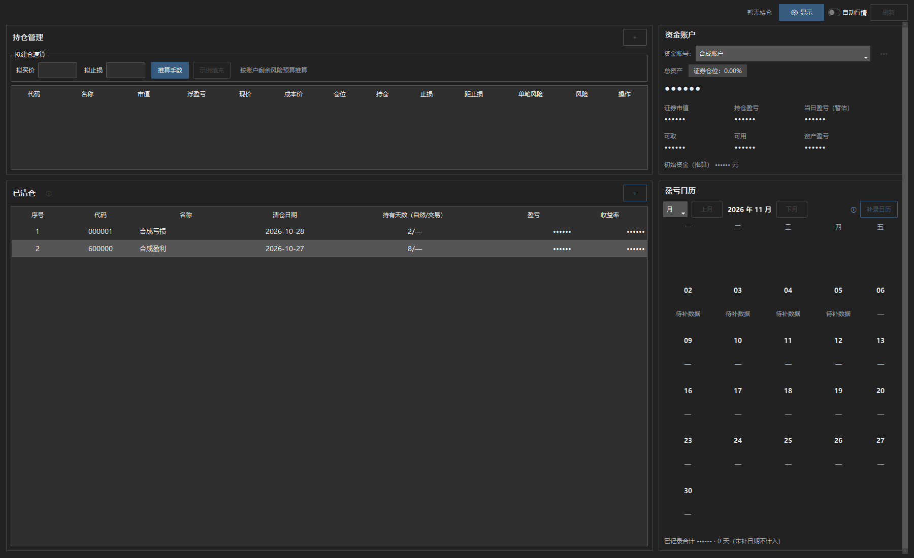
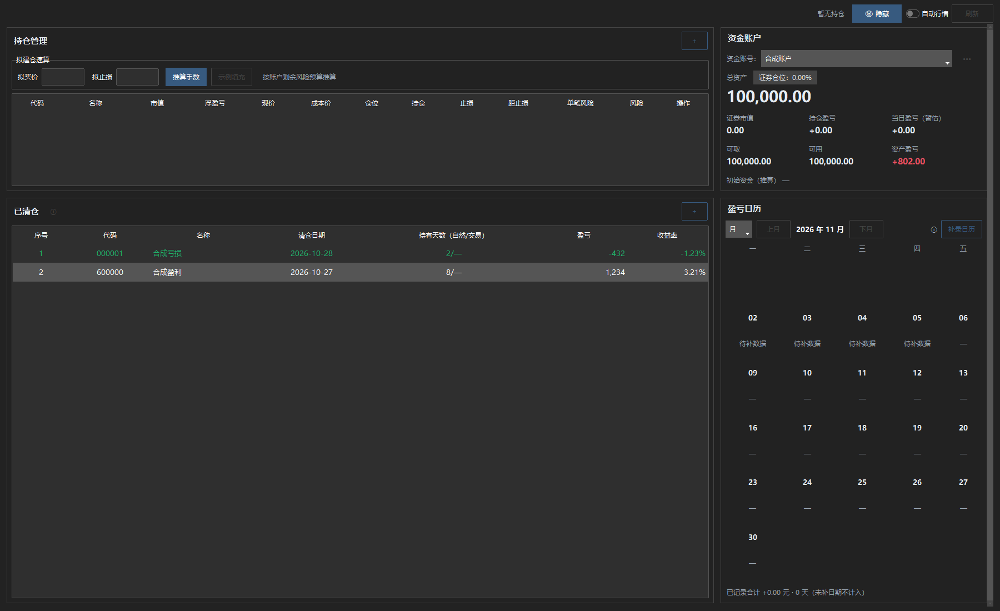
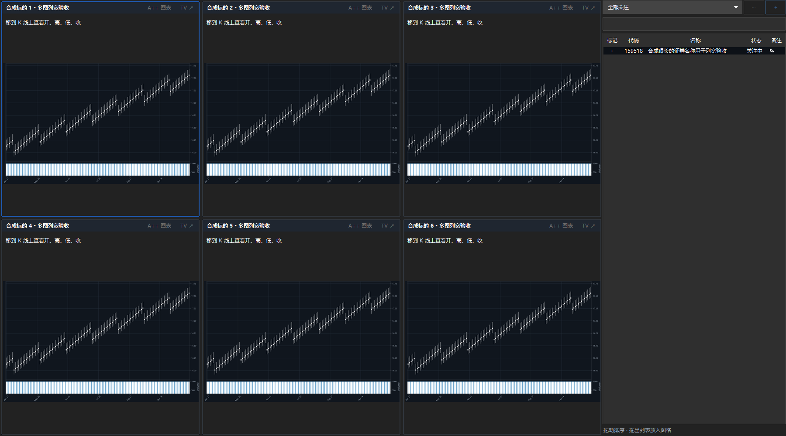
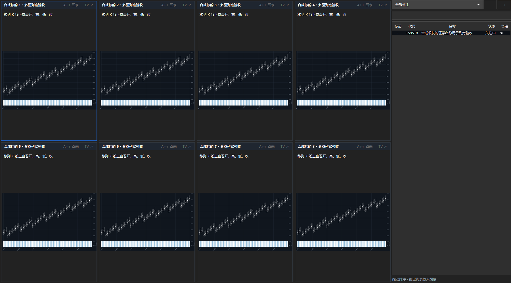
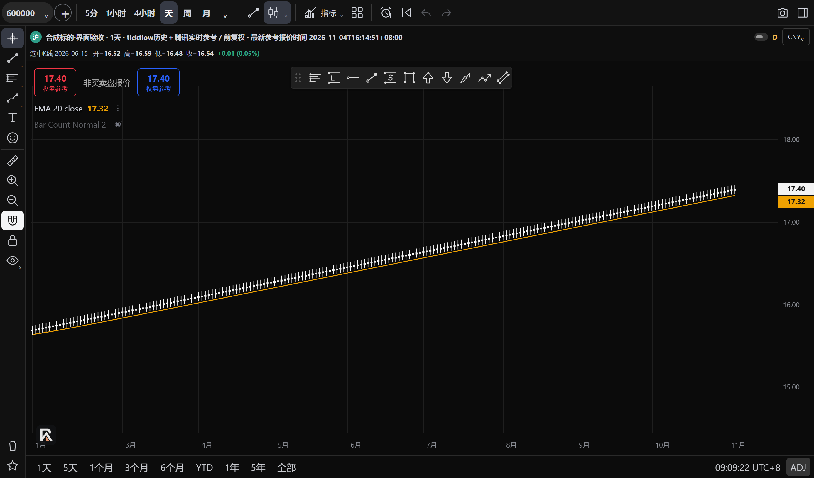
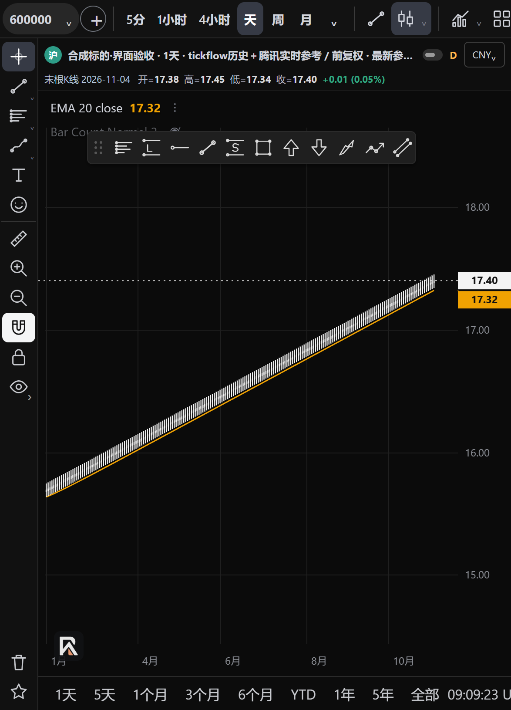

# 界面布局与隐私修复验收

- 类型：R1 显示层修复，覆盖用户逐项确认的 9 个问题。
- 主线基线：`ad35a1cb9d1fa689cac9a7fd200c5253a9115fe2`。
- 实现及测试提交：`7c85c7fa1036f40e11ffe85a1423b0bf7560e051`；后续提交只补本验收记录。
- 环境：Windows 11、Python 3.12.13、本机 Tk 与 WebView2；Tk 几何专项设置为 96 DPI。全程使用临时生成的账户、行情和 Store，没有读取用户日常运行库、旧项目数据库或请求行情服务器。

## 逐项结果

| 问题 | 实际修改与验证 |
|---|---|
| 1. 交易管理上下高度失衡 | 顶部以约四分之一为目标，保留内容最低高度，其余空间交给清仓和日历；空持仓仅请求一行，已有持仓请求三行后滚动。 |
| 2. 资金指标纵向分散 | 账户、总资产、六项指标和对账说明在顶部紧凑排列，不均摊剩余高度。 |
| 3. 底部记录／日历受挤压 | 宽窗口完整显示下方区域；窄窗口切单列并保留滚动可达性。画布在 Tk 完成排版后重算高度，避免沿用旧的过大请求尺寸。 |
| 4. 持有天数浮层遮挡 | 移除绑定整个清仓表的大段提示，标题旁 ⓘ 的短提示指向点击说明，保留原计算口径、缺数据说明与排序。 |
| 5. 历史 OHLC 与最新报价混淆 | 来源／参考时间与 OHLC 分行；光标对应历史柱时显示“选中K线 日期”，移出恢复“末根K线 日期”。最新参考框不跟随历史光标改价。 |
| 6. 价格轴标签重叠 | 收盘、EMA 和人工价格标签统一避让，间隔至少 22 CSS 像素；偏移标签有引线。真实价格坐标、均线、水平线与计算数值不移动。 |
| 7. 关注列表列宽分配欠佳 | 表头／六位代码／当前状态按字体测量，标记和备注保持紧凑，名称取剩余空间；可选行情列过多仍横向滚动。 |
| 8. 多图宽度不平均 | 网格按相同 uniform 组分配可见行列；六图、八图、切换单图后恢复及调整窗口均验证尺寸差不超过 1 像素。右侧列表保持 420 像素测试宽度，不被自动缩窄。 |
| 9. 清仓盈亏未隐藏 | 隐私关闭时盈亏金额／收益率均为掩码，清除盈亏行色；展开恢复原数值／颜色，再次进入页面恢复隐藏。原位更新，保留清仓顺序、选中行和账本。 |

一键来源的可见性、行情完整性提示及两个列表的独立选中状态按用户要求排除，未修改。未调整候选结果区域的空白分配。

## 本地验证

[机器回执](ui-layout-regression.json)；[真实 WebView 显示回执](ui-layout-webview.json)。

1. 相关集合 **241 passed / 152.72s**：`test_ui_layout_privacy`、`test_workspace_watchlist_ux`、`test_holding_duration`、`test_holding_quotes`、`test_desktop_layout`、`test_afterhours_desktop`、`test_live_reference`、`test_tv_workspace_prototype`、`test_chart_embedded_workflow`、`test_chart_switch_transport`、`test_chart_snapshot`、`test_chart_indicator_sources`、`test_global_auto_quotes`。
2. 最终交易比例／空持仓调整后，`test_ui_layout_privacy`、`test_workspace_watchlist_ux`、`test_holding_duration`、`test_holding_quotes`、`test_afterhours_desktop` **105 passed / 120.24s**，无失败、错误或跳过。与上组重叠，不能累加为独立测试数。
3. 最后采用隐藏 WebView 生成稳定图片后，`python -m pytest -q tests/test_ui_layout_privacy.py` **4 passed / 11.39s**。
4. `node tests/chart_readout_layout.cjs` 直接执行生产显示函数，核对历史 14.86 与最新 17.40 分别保留、OHLC 日期、轴标签边界／间隔及水平线原坐标；原 tools／live／timeframe Node 回归通过。
5. `python tests/ui_display_probe.py <隔离目录> --screenshots` 使用真实 WebView2、实际生产页面物化与脚本，核对宽／窄图格的分行、历史／末根日期、17.40／17.32 两标签及无 JS 运行错误。截图调用 WebView2 CapturePreview，只取该渲染器内容。
6. `verify_frozen()` 返回 `185541a4c226af123a36d113ca741c1b207a5413cd6fb6b4fd980381f0ff312c`；冻结文件、workbench、schema、配置、行情路由、CI 与发行代码无改动，`git diff --check` 通过。

首次本地原生验证发现的 Tk 布局常量错误已修复；以上成功结果来自修复后的回归。警告为现有 pandas／NumPy resample 弃用提示。

## 截图复核

图片均为合成数据。交易管理为真实 Tk 控件截图；六／八图截图用真实网格和兼容图片渲染器验证排布，**不是同时运行八个 WebView 的截图**。默认图表的实际脚本和价格读数另由真实 WebView2 探针验证。

## 边界与交付状态

- 这是代码／原生界面及合成数据验证，不是当前服务器行情完整性、真实账户金额或长期跨交易日验收；没有重建安装 EXE，也没有发布 Release。
- 窗口高度不足或打开大量可选列时保留滚动，不承诺任何尺寸都无截断。轴极度拥挤时优先保留收盘和 EMA，再显示容纳得下的人工标签，人工线及原始价格仍保留。
- 隐私新增范围是清仓表的盈亏及收益率；持仓表和主动打开的编辑／图表窗口沿用既有范围，不是全屏遮罩。
- 开工活动 PR105 也修改 `gui/chart_panel.py`，目标为 PA 空间。本次只改网格行列分配，不接入其功能或假定合并顺序；合并时应保留双方有效改动。
- 按 R1 运行目标和相邻模块回归，未无条件再跑完整 pytest。PR 创建后仍需 GitHub 必需 CI 和人工批准，不自动合并、不轮询 CI；不能把本地通过当作已发布或已合并。
