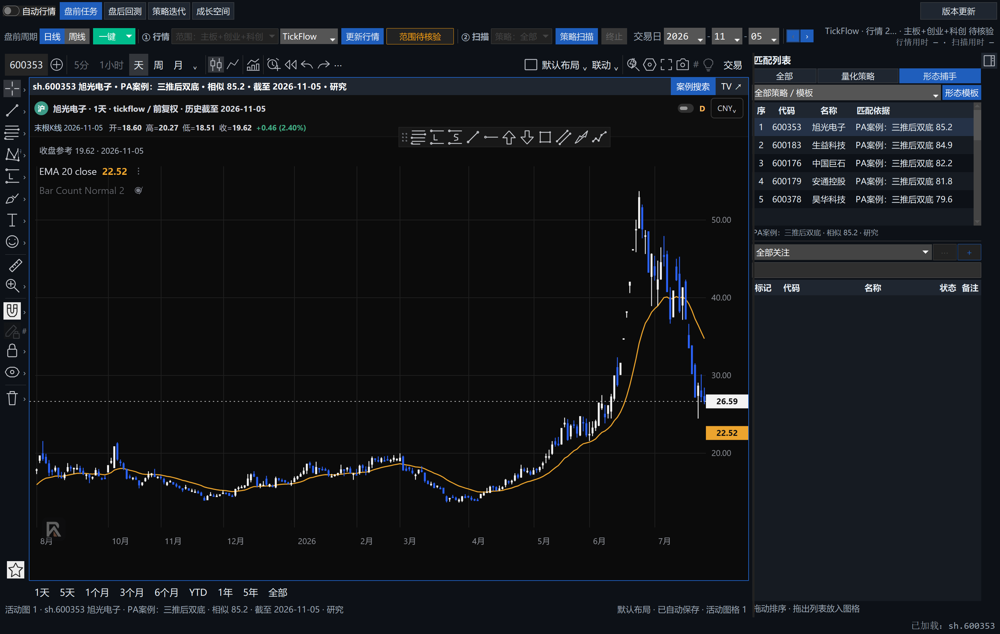
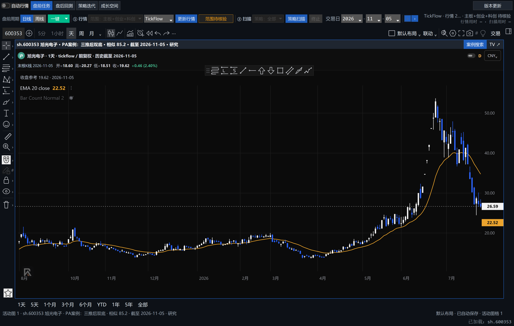
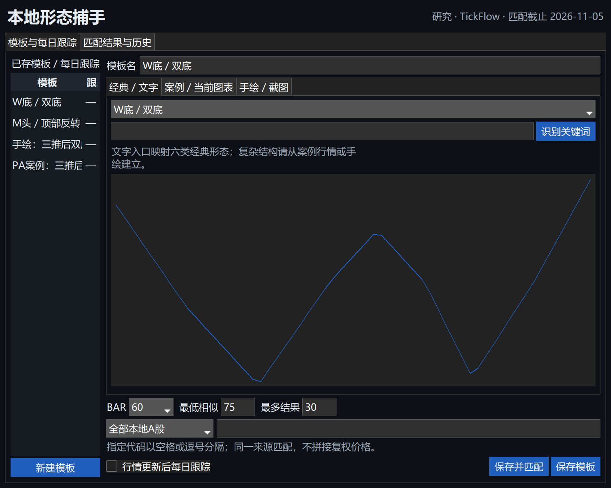
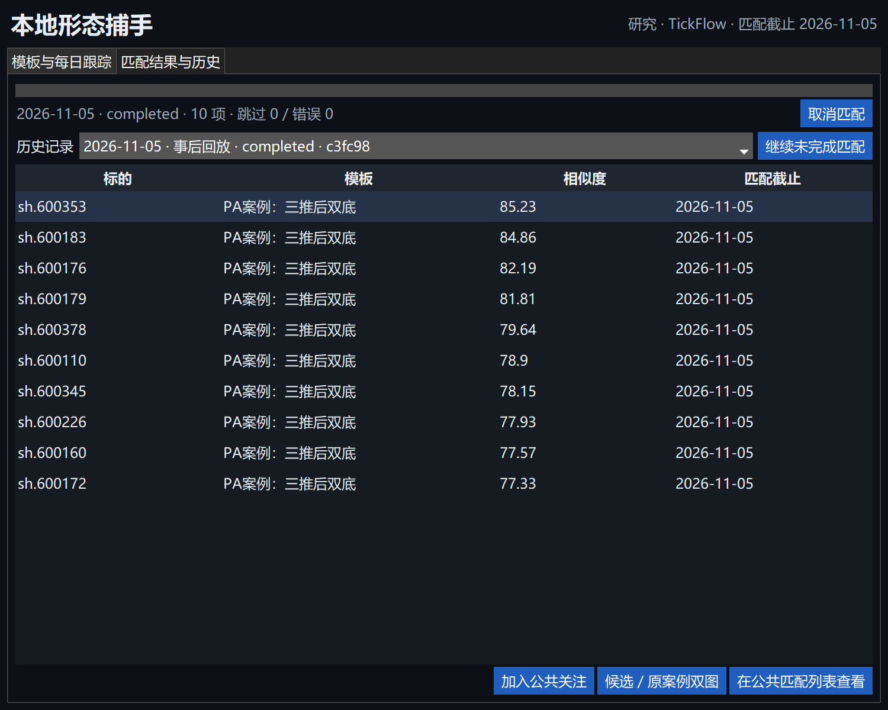
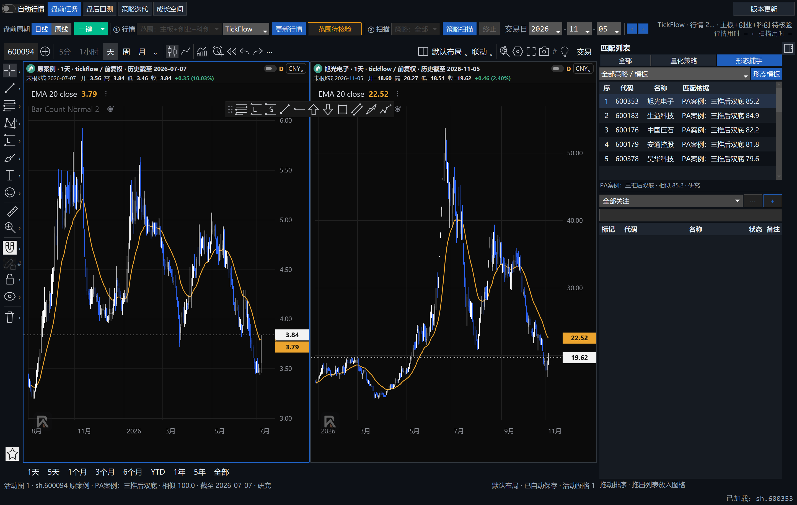

# 本地形态捕手 V1 与公共匹配列表验收

分支 `codex/local-shape-catcher-v1`，基于主线 `4262418`。这是开发交付证据，不能代替 GitHub 必需 CI、交易员人工批准或长期实际使用。

## 交付行为与边界

公共匹配列表采用“全部／量化策略／形态捕手”与次级策略／模板筛选；沿用公共日期、公共关注、右侧收放、白蓝K线及绘图工作区。支持六类经典模板、明确关键词、真实日线案例、手绘、保守截图轮廓识别、历史回执、取消／恢复点和后台每日跟踪。

Store 只新增研究公开方法，没有增加表或修改 schema。研究结果不进入 observations／plans；关注仍写同一 watchlist，并保存完整来源依据。正式策略、指标、冻结清单、行情下载协议与交易账本未修改。共享文件影响包括 Store 包装方法、Service 的低优先级队列触发、ChartItem 可选 shape 字段及布局验证、公共列表和成长空间桥接；没有整文件覆盖其他模块。

## 代码与桌面验证

Windows / Python3.12，现有锁定环境，无新增依赖。

- 形态专项覆盖来源／复权／未来数据隔离、模板版本校验、历史回看、多重依据、关注原子回滚、取消、恢复重排和崩溃恢复点。
- 原生桌面测试覆盖来源筛选、日期、列宽、后台刷新不抢图、手绘／案例保存、图表真实前缀、布局新旧字段兼容。
- 最终形态／桌面／日期／PA入口组合 **102 passed**（49.39秒）；随后新增的行情任务完成自动触发专项 **1 passed**（2.07秒），验证正式行情回执不被形态任务改写。
- 相邻回归已运行：桌面／日期／隔离／更新器 **127 passed**；盘前、扫描、关注、共享图表、成长空间分发等 **236 passed**；布局及图表相邻组 **101 passed**。这些组有重叠，不相加宣称独立总数。最终变更专项结果见 PR 描述与下方补记。
- 冻结校验通过，摘要 `185541a4c226af123a36d113ca741c1b207a5413cd6fb6b4fd980381f0ff312c`。
- 首次相邻测试的 Windows Script Host 与更新器临时目录权限失败，在正常本机执行环境中消除；未删测试或放宽门禁。

未执行不相关的整仓本地回归；按 R2 覆盖直接模块与相邻契约。PR 的必需 CI 仍须通过。

## 真实行情与端到端耗时

只读提取 Aplus 当前正式仓的不可变 TickFlow 快照，复制到 `.test-shape-real/20261106/runtime`，没有打开旧工程数据库，没有复制账号／持仓／凭据，也没有写正式使用仓。复制准备耗时48.22秒，不计为匹配性能。

行情截止2026-11-05，3,197只沪深主板股票，W底、M头及手绘轮廓同时匹配，阈值70、每模板最多10项：

| 阶段 | 首次匹配 | 同身份再次校验与复用 |
|---|---:|---:|
| 文件读取 | 29.64s | 3.71s |
| SHA验证 | 0.33s | 0.30s |
| 解析与字段验证 | 22.84s | 0.05s |
| 计算 | 1.37s | 0.00s |
| 最终回执保存 | 0.013s | 0.013s |
| 端到端 | **60.26s** | **4.20s** |

再次运行复用3,191份已核验输入的评分；首次得到30项结果、无计算错误。另有21条跳过原因，包含当日无K线或对应模板长度不足，不能把它们当成未命中。耗时包含真实文件、SHA、CSV解析、计算、取消检查、让出执行和保存；不是纯 NumPy 基准，也不外推为其他机器或行情源的固定速度。

## 真实私有案例

按用户指示只读查看正式私有案例原图，找到大名城600094日线中的箭头与通道。验证模板采用2025-12-01至2026-07-07共144根真实行情，截止点按图上绿色确认箭头解释；**该人工解释仍需交易员确认，可在界面调整**。此后的走势不进入模板。

使用该案例模板在300只真实主板股票中检索，120 BAR、阈值60、最多10项，端到端3.81秒，得到10项可打开真实K线的候选。没有凭截图生成价格。案例原图、私人笔记及原始数据库未提交 GitHub。

## 实际运行截图与交互

`tests/shape_desktop_probe.py` 对隔离真实数据运行完整桌面和内嵌 WebView，使用应用自身 HWND 截图，避免混入其他前台应用。通过以下断言：

- 收起后中央图扩大；恢复前后日期、来源、候选、宽度相同；图表进程和会话 token 相同。
- 新旧 ChartItem 都可使用原布局保存／恢复，不触发布局恢复错误。
- 案例双图仍为原图表引擎，左图末日2026-07-07，右图末日2026-11-05。

## 原型差异与仍需人工验收

聊天工具返回了确认的文字设计，但未返回其中的原型图附件；用户在本聊天提供的截图指向聊天位置，并不是原型图。因此不能宣称已经做过逐像素对照。本轮按最新main与确认的控件组织实现，并提供实际截图供对照。

保持五个业务模块的既有规则。截图使用未建交易账户的隔离仓，因此交易管理入口按原规则隐藏，不是本功能删除了模块。右侧上下比例沿用既有布局；模板管理为低频窗口，结果历史独立为同窗口一页，避免高DPI挤压输入区。

截图识别仅为有校验、需确认的蜡烛颜色轮廓；不具备任意截图OCR、PA语义理解或自动恢复OHLC。截图原图的箭头不会自动转换为左侧图表对象，可返回原案例查看。V1真实行情模板限已有日线快照；分钟数据不伪装为日线或反之。

每日跟踪的触发、等待业务任务、取消与恢复已通过代码测试；没有跨多个实际交易日的长期运行验收。未制作和安装新的正式发行包；已验证模块分发与既有进程入口契约，正式包由原发布流程产生。

## 交易员人工验收步骤

1. 更新本地代码后打开，选择已有日期，分别查看三种来源；具体策略／模板筛选和日期保持正确。
2. 打开形态模板，选择W底／M头，保存匹配；回到公共列表点股看图、翻页、加入关注，再切回量化策略。
3. 从真实PA案例点击寻找相似股票，核对代码与截止K线；检查双图和返回原案例。
4. 画一条轮廓并匹配；导入清晰截图框选测试；拒绝错误识别后应仍可手绘。
5. 开启每日跟踪，下一次更新行情后查看后台进度；正式扫描优先、旧结果可继续查看。
6. 收起／恢复右侧，在单图、多图、全屏、缩放及绘图后核对状态；退出重启验证布局仍可恢复。

本记录随PR交付；GitHub CI、人工批准、实际合并与长期使用分别验收，不提前代替。
