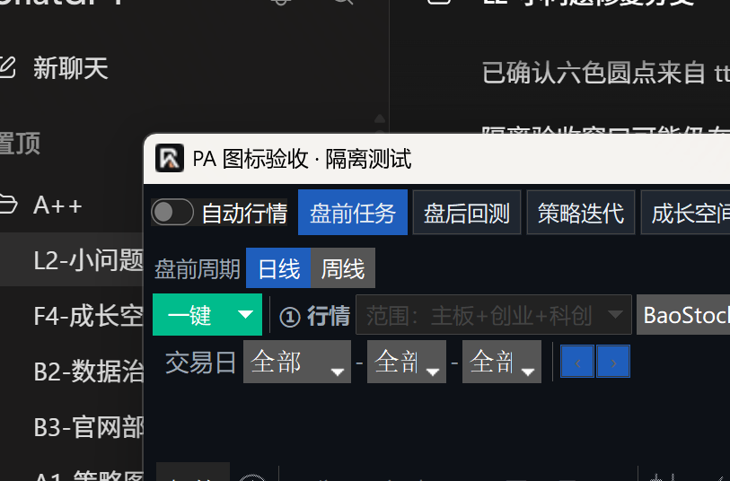

# Windows 主窗口 PA 图标修复验收

## 范围与结论

R1 用户可见界面缺陷修复，基于 `main` 的 `a02cb8e3b1ab1752d7880bde2fbfe24b66234faa`，分支 `codex/fix-pa-window-icon`。

生产修改仅在 `gui/main_window.py` 与 `workbench/branding.py`：禁止主窗口加载 ttkbootstrap 默认图片；明确设置当前窗口及后续子窗口的 PA 图标；资源缺失、明显损坏或 Tk 设置失败时记录诊断并继续业务启动。

没有修改 Logo、ICO、AppUserModelID、快捷方式、安装器、更新协议、全局缓存、Explorer 设置、布局、图表、策略或数据模块。没有部署到正式安装目录，也没有打开用户数据库。

## 根因与对照证据

本机 `ttkbootstrap==1.20.1` 的 `Window.__init__` 在 `iconphoto=''` 时读取 `Icon.icon`，创建默认 `PhotoImage` 并调用 `iconphoto(True, ...)`；显式传入 `None` 才跳过。提取的内置图片就是用户看到的白底六色圆点：


旧初始化随后只调用 `iconbitmap(default=...)`。Tk Windows 的“类默认图标”和“当前窗口图标”是不同设置路径，后者通过 `WM_SETICON` 设置；仅覆盖默认值不能可靠清除已设置的框架图片。这与本机正式版仍显示六色圆点的现象一致。实现依据可核对 [Tk Windows 图标设置源码](https://github.com/tcltk/tk/blob/core-8-6-branch/win/tkWinWm.c)；读取图标遵循 [Windows WM_GETICON 的回退规则](https://learn.microsoft.com/en-us/windows/win32/winmsg/wm-geticon)。

在独立 Windows Tk 进程中对照：

| 初始化 | 原生读取结果 |
|---|---|
| 旧框架默认图片 + 仅设置默认 ICO | 本机隔离复现中出现无效原生图标句柄；不据此声称每次都出现同一画面 |
| `iconphoto=None` + 仍只设置默认 ICO | 大图标匹配，小图标／small2 未匹配批准资源 |
| `iconphoto=None` + 当前窗口、默认 ICO 同时设置 | small、large、small2 全部匹配批准资源；后续子窗口也匹配 |

原生像素参照由同机无框架默认图片的真实 Tk 子窗口显式加载 `icon_aplus.ico` 产生；另保留原有文件 SHA、七种分辨率、启动器 PE 资源安全断言。不能把 Windows `LoadImage` 的独立缩放与 Tk 的 ICO 解码差异当成产品失败。初期探针未可靠处理原生回退／解码差异，其结果未计入通过证据。

额外的资源异常小样本确认：本机 Tk 会接受一份非 ICO 内容文件，静默显示普通文件图标而不抛错。因此增加六字节 ICO 头检查，只用于发现明显损坏并记录路径，不新增图标转换、品牌资源或启动门禁。

## 真实任务栏截图

2026-11-07，本机未改动正式版与隔离修复版同时运行。任务栏自动折叠时没有应用图标，因此临时打开开始菜单展开任务栏后拍摄，未改变系统设置。下图是原始任务栏截图的局部裁切，未重绘、替换或合成图标：**左为未修改正式版的六色圆点，右为修复后隔离主窗口的 PA 图标**。


修复版真实窗口，空白列表来自未连接用户数据的隔离验收，不代表正式行情丢失：



## 验证结果与限制

Windows / Python 3.12.13 / Tk 8.6.12 / ttkbootstrap 1.20.1，使用现有依赖。主窗口使用真实 `AplusMainWindow`；没有 Store/service 或正式数据连接，关闭自动版本检查，不触发行情下载。

| 场景 | 状态与证据 |
|---|---|
| 新进程首次打开主窗口 | **通过：隔离源码运行**。标题栏、真实任务栏目视检查及原生大小图标像素校验一致；不是正式安装版启动验收 |
| 最小化后恢复 | **通过**。真实窗口生命周期测试及系统菜单最小化后恢复，small／large／small2 仍匹配 |
| 隐藏到托盘并恢复 | **通过：原生集成测试**。真实 pystray 通知图标及其菜单回调，经原有 Tk 队列恢复窗口；没有 Mock 托盘或直接替换恢复方法。未实点系统托盘菜单 |
| 后续子窗口 | **通过**。各次恢复后新建真实 Tk 子窗口，继承批准图标 |
| Alt+Tab | **通过：隔离源码运行目视检查**。实际打开切换器，隔离窗口条目显示 PA 图标；其他应用预览未提交仓库 |
| 托盘退出 | **通过**。真实菜单退出回调关闭主窗口和托盘线程；额外隔离探针按自身计时退出，未留驻验收窗口 |
| 图标丢失／损坏 | **通过**。真实窗口仍能创建并显示工具栏，日志保留图标路径；另覆盖当前／默认设置的 TclError 和 OSError |
| 从正式安装版桌面快捷方式启动修复版 | **未验证**。本轮没有制作或安装候选发行版，未动正式桌面快捷方式 |
| 实际软件更新并重启 | **未验证**。未修改更新协议，也没有对正式使用版执行安装更新；普通新进程通过不能替代此项 |
| 长期偶发问题不再出现 | **未验证**。本轮验证不能承诺所有机器或长期运行均已验收 |

定向测试：

```text
python -X utf8 -m pytest -q tests/test_brand_runtime_icons.py tests/test_window_icon_lifecycle.py
13 passed in 15.79s

python -X utf8 -m pytest -q tests/test_desktop_layout.py tests/test_native_ui_setup.py
50 passed in 4.01s
```

托盘停止消息的线程收尾增加最多3秒的有界等待后，原生完整生命周期专项复验 **1 passed in 6.91s**，与上述13项有重叠，不另外累加。

保留了批准 ICO 与品牌清单 SHA／七帧、工作目录无关、无 Store 依赖、真实启动器 PE 图标、快捷方式目标不变等既有断言。首轮新增测试中两个前提不正确：pystray 的 `visible` 属性在 stop 后仍缓存 True，以及 Tk 不一定拒绝损坏 ICO。前者改为断言真实窗口和托盘线程已关闭，后者增加真实资源诊断后通过；没有移除既有安全断言。

未运行全量 pytest；R1 仅图标、主窗口、托盘及必要相邻检查。没有新一轮真实行情或交易数据验证。独立 PR 创建后不等待 CI，不自动合并；GitHub 必需 CI、交易员人工批准、实际合并和发行版使用验收分别确认。
