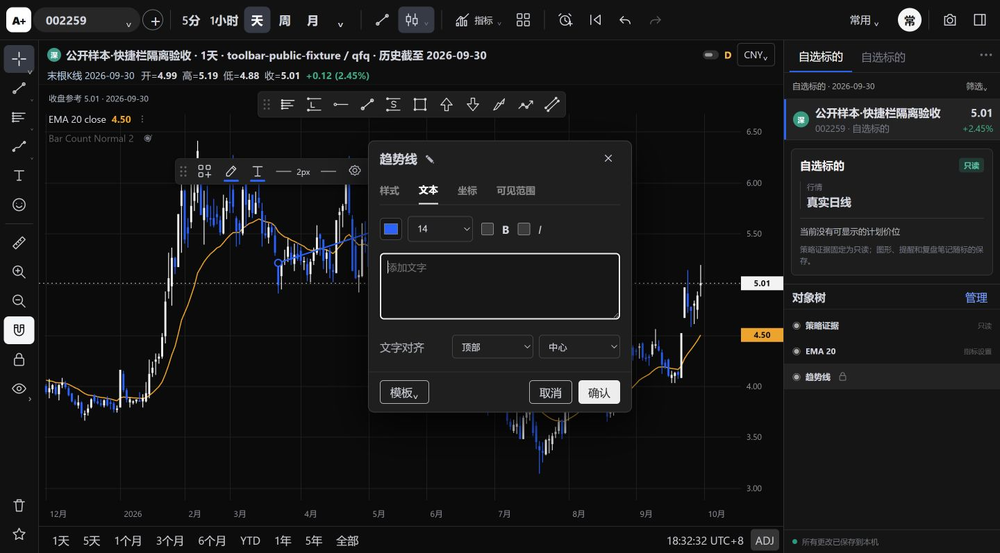
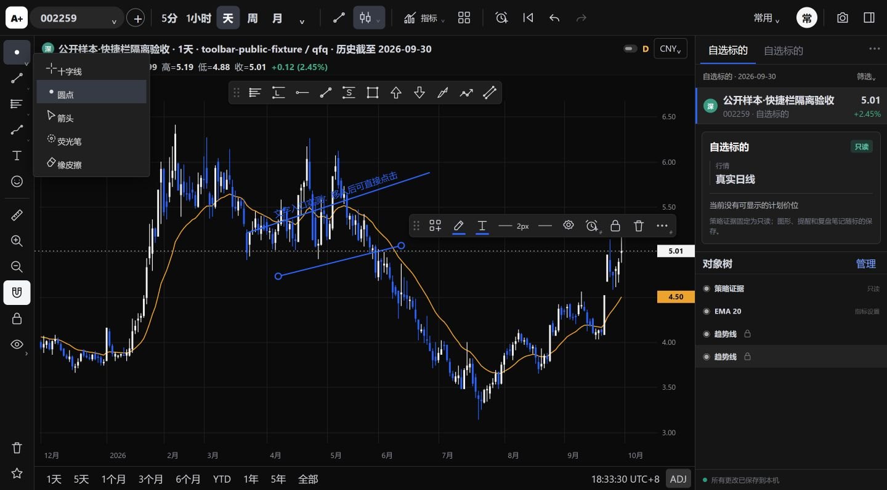

# 图表使用反馈修复验收

本轮依据用户提供的使用反馈文档及19张配图，修复最新主线图表操作。原文“11”出现两次，以下保留为11a与11b，共15项。开发基线为 `04bdf1a`，独立分支 `codex/chart-trader-feedback`。本记录不是已发布声明。

任务类型为修复，风险R2：范围为标绘渲染、手势、设置窗口、共享光标命令和窗口最小尺寸。保留行情、策略、计划、提醒、图形的日期价格存储格式和Store写入边界；不访问正式用户数据、不改schema、不升级依赖或CI。

## 逐项结果

| 原反馈 | 交付行为 | 本轮证据 |
|---|---|---|
| 1 自适应比例 | 主窗口最小800×520，独立图表480×360；画布继续分别跟随容器宽高 | 真实Tk验证1200→820同高及800×520；真实可见WebView复核480×360和800×520，窄图可用性限制见本轮评审记录 |
| 2 指标设置可拖动 | 现有模态设置统一通过标题栏拖动，缩放后约束在视口内，打开时重新居中 | Chrome实操EMA和通道属性；原生探针验证边界 |
| 3 仓位方向线 | 入场锚点连接覆盖范围内最后可见K线收盘价，支持多空并尊重回放截断 | 实际生产绘制函数检查终点及未来隔离；风险计算保持原样 |
| 4 沿线文字和悬停 | 文字按实际屏幕线段旋转；非空文字悬停显示全文，空文字出现添加入口 | 生产绘制函数记录rotate；Chrome实操沿线通道文字和提示 |
| 5 起点终点布局 | 两个紧凑端点控件放在线形图预览同一行，普通／箭头分别设置 | TV实操原菜单确认；原生WebView验证实际DOM位置 |
| 6 右键取消 | 未落点、一点、通道第二点阶段均可右键取消；右键不进入左键绘制逻辑，恢复箭头光标 | 原生生产事件处理器三阶段回归，无新增对象与撤销步骤 |
| 7 添加文字 | 支持文字的现有工具在悬停时显示“＋添加文字”，直达对应文本页；路径也开放文本页 | Chrome通道入口→文本→确认实操；Fib继续使用已有逐级文本入口，仓位不伪造文本属性 |
| 8 小箭头文字 | 文字在尾部之外，字号和标记大小参与布局，不遮挡箭身 | 生产文字定位与渲染检查 |
| 9 小箭头锚点 | 向上／向下箭头尖端等于实际存储锚点；圆形手柄位于尖端 | 生产路径第一个点与锚点一致检查；未移动已有分析锚点价格 |
| 10 通道三阶段 | 前两点只预览基准线，第三点才生成平行边界及背景 | TV与Chrome实操；原生探针确认前两阶段无新增对象、第三点只提交一次 |
| 11a 六点及通道文字 | 四角调角度、两中点调宽；保持平行和原日期价格语义；顶部按实际画面上方边界定位 | TV六点实操；真实WebView六手柄；生产函数覆盖正负宽度和六类调整 |
| 11b 大箭头文字 | 文本放在起点外，按方向选左／右对齐或上下基线，长文字不从中间覆盖箭身 | 生产文字布局回归 |
| 12 光标 | 独立页面和主工作区原生左栏均可选择十字线／圆点／箭头／荧光笔／橡皮擦，图标跟随状态 | TV核对菜单及荧光笔；真实原生菜单和1／4／6／9图命令传递回归 |
| 13 尺子 | 拖动显示临时矩形、横纵双向箭头及幅度／根数；右键或外部点击移除，不进对象树、历史和Store，不显示设置条 | TV与Chrome实操；原生事件回归及Store保存重开检查 |
| 14 水印 | 图内完全移除Aplus水印节点，没有改成图内角标；顶部应用标识仍在 | Chrome截图及真实WebView节点断言；不再使用的图标复制／CSS另列清理项 |

## 实现边界

复用现有绘制函数、三个通道锚点、图形属性和保存队列。增加通道几何计算，供六点手柄及文字定位共用；不另建绘图引擎。新增文字提示、光标指示及测量都是视图状态；临时测量没有持久化副本。原有已经保存的兼容价格范围对象仍可读取，不删除旧对象。

右键在pointerdown前区分鼠标按键，避免右键先误绘再取消。操作中的图形移动取消恢复原快照；既有撤销／重做和颜色透明度编辑链保留。人工标绘继续绘制在overlay层，悬停文字提示不会重建基础行情画布。

冻结清单SHA-256仍为 `721fcd78d9f9d46cf92507e66d35b75385b40c2a8c4b3fcd4e7a4d569762ffcf`。`core/`、`config/`、`frozen_manifest.json`、`workbench/store.py`无改动。

## 验证分类

代码与原生验证的相关集合共17项，已分组通过。所选范围：

```powershell
python -m pytest -q tests/test_chart_trader_feedback.py tests/test_drawing_quickbar.py tests/test_tv_workspace_prototype.py tests/test_workspace_toolbar.py tests/test_chart_embedded_workflow.py::test_slot_asset_urls_change_with_content_but_not_symbol --basetemp .test-fb1108 --tb=short
```

该轮15项通过、2项待修正测试前提：新探针使用隐藏页时，WebView在第二次调整尺寸后暂停视口更新；旧共享探针仍假设“光标”主按钮永远选择十字线，现在该组会记忆箭头。改用明确标识的可见隔离窗口，并从真实原生菜单明确选择十字线后，最终复验：

```powershell
python -m pytest -q tests/test_chart_trader_feedback.py tests/test_workspace_toolbar.py --basetemp .test-fb1108-final --tb=short
```

**4 passed，91.42秒**。其余13项有效证据复用，包含真实Store重开、绘图、时间周期、实时刷新、策略展示相邻契约和资源内容版本检查。此前14条warnings为现有pandas／NumPy时间单位弃用提示。本轮未运行完整pytest。

最后补充切周期／取消手势时清理临时尺子后，单独复验 `test_feedback_workflow_in_real_webview`：**1 passed，7.72秒**。结构化原生结果见[隔离探针记录](images/chart-feedback-20261108/native-result.json)。

另外 `node tests/chart_tools_regression.cjs`、`node tests/chart_workspace_controls.cjs` 及相关JS语法、Git差异检查通过。Node检查直接调用生产绘制与几何函数。原生事件探针对合成PointerEvent缺少操作系统捕获的前提替换了捕获方法，未替换生产手势处理器；真实鼠标拖动由Chrome另行验证。

首次多图探针还遇到Windows长路径导致IPC临时文件创建失败，已读取进程回执确认并改用短的隔离测试路径，没有因此更改生产IPC、终止用户进程或清理使用环境。

真实数据类别：Chrome使用仓库已包含的公开BaoStock历史样本，Store为新建隔离目录；原生回归使用明确标识的合成行情。没有对用户持仓、正式分析或当前市场数据做验收。原生WebView记录的devicePixelRatio为2；其他Windows缩放比例的长期验收未完成。

## 画面证据


## 待人工验收

在最新安装版中按原文15项连续操作，重点确认主窗口并排使用、不同斜率的文字与通道控制点、各类箭头文字、右键取消和尺子消失的手感。荧光笔使用临时光晕指示，TV下方长按数值提示开关及菜单收藏星不属于本轮新增功能，未宣称这些细节已完全还原。Bar Count未新增设置页或计算功能；拖动能力覆盖现有模态设置窗口，后续新增指标页须沿用同一交互。

长期跨日使用、多台设备和全部DPI、交易员人工验收尚未完成。GitHub CI在PR提交后后台运行，本轮不等待、不自动合并，不将此记录代替人工批准或正式发布。

## CI小屏修复

用户反馈首次CI失败后，核对PR119的 `1cdce8b`：A acceptance运行 `42448071437`、job `128631145612`，Windows全量结果为 **2553 passed / 2 failed / 302 warnings**。本轮仅修复这两个失败主题，不修改工作流或验收阈值。

- 新增主窗口测试错误地假设桌面能够容纳1200像素宽窗口，托管桌面的窗口管理器只允许约1028像素；现按实际 `maxsize()` 选择两种不同宽度，仍断言目标尺寸精确生效、同一高度及图表可见，并增加1028×740人工尺寸上限用例。
- 放宽主窗口最小尺寸后，盘后清单的62%宽度上限会将预览挤到348像素。新增真实Tk用例在100%缩放下复现同样的348像素失败，再给预览保留360逻辑像素（随DPI放大），相应限制清单占宽；原有列最小宽度、横向滚动和清单展开行为保留。原完整盘后用例的 `preview_host > 350` 等断言均未放宽。

最终定向命令：

```powershell
python -m pytest -q tests/test_afterhours_desktop.py::test_small_desktop_reserves_readable_preview_width tests/test_afterhours_desktop.py::test_real_desktop_layout_filter_replay_navigation_and_return tests/test_chart_trader_feedback.py::test_main_window_can_shrink_horizontally_without_fixed_aspect --basetemp .test-cifb-fixed --tb=short
```

**4 passed，26.36秒**。全部使用隔离Store和原生窗口，覆盖普通／小屏上限、盘后筛选复盘返回及清单展开收起。本轮未跑本地全量pytest，未触及策略、数据存储格式、行情、用户运行目录或CI；新提交的GitHub验收仍待后台运行，PR保持草稿与人工批准要求。

## 2026-11-08 评审修正：文字入口、光标恢复与通道边界

针对PR119讨论区三份评审（最后核对的旧head为`f18a074`），本轮继续在原分支修复，风险仍为R2，不新建PR、不改策略或行情。此节为最新修正与验收记录；前述历史测试结果不冒充本轮新提交的CI。

| 评审项 | 处理结果与验证 |
|---|---|
| P2 文字提示移入即消失 | canvas移入兄弟提示按钮时保留提示；真正移出提示区域才隐藏。真实Chrome鼠标从趋势线移至“＋添加文字”并点击，文本页打开且输入框获焦；真实WebView同样覆盖事件边界 |
| P2 正常完成丢失十字线 | 正常完成恢复用户所选普通光标；右键或Esc取消绘图才切箭头。原生探针对四种普通光标逐一完成趋势线验证；Chrome实操圆点→绘图→菜单仍选中圆点 |
| P2 光标保存／恢复 | `cursor_mode`加入恢复白名单，显式十字线也保存；通过真实ChartBridge和隔离Store保存后，重建生产页并真实重新加载，十字线／圆点／箭头／荧光笔全部恢复。橡皮擦仅当次开启，不覆盖原普通光标，旧存档中的橡皮擦值也不在启动时激活 |
| P2 通道同K线退化 | 创建第二点、角点拖动及坐标输入均拒绝A/B同K线；拒绝不新增对象或撤销记录。已有不同日期投影到同一周/月K时，仅绘制锚点间线段并保留原始坐标，不用分母`1`伪造延伸；恢复原周期仍走既有日期映射 |
| P3 橡皮擦右键退出 | 加入右键取消路径，Esc同样退出且保存箭头；原生与Chrome实操核对 |
| P3 零距离尺子 | 单击不拖动或同一测量坐标直接清除；继续不进对象树、撤销记录或Store |
| P3 HTML拼接 | `commonLineSettings`增加显式端点片段参数，替代对首个`</div>`做字符串替换；原生DOM断言两个端点仍在同排 |
| P3 最小尺寸 | 真实Tk分别在普通桌面及1028×740上限下缩至800×520，并断言精确尺寸及图表可见；真实WebView补480×360和800×520 |
| “尺子程序化切周期残留” | 复核不成立：周期切换已调用`cancelChartGesture()`清除尺子。补直接调用周期切换函数的回归，不增加重复清理补丁 |

### 本轮验证证据

生产代码只改两份JS：`prototype-interactions.js`和`drawing-settings.js`；其他为定向测试、说明、截图和本记录。Store/schema、正式数据及冻结规则不变。

本地分组定向验证共18个不同用例通过，未运行完整pytest：

- `tests/test_chart_trader_feedback.py`原组：3 passed / 15.32秒，包含两个原生Tk窗口尺寸案例。之后扩充真实重新加载检查，单独复跑其中WebView案例：1 passed / 7.64秒。
- `tests/test_workspace_toolbar.py`：2 passed / 87.95秒，覆盖原生共享工具栏及1／4／6／9图真实命令链。
- 最终轻量组 `tests/test_drawing_quickbar.py tests/test_tv_workspace_prototype.py tests/test_chart_embedded_workflow.py::test_slot_asset_urls_change_with_content_but_not_symbol`：13 passed / 14 warnings / 5.94秒，警告来自已有pandas聚合弃用提示。
- Node工具几何、共享命令、跨周期绘图、行情读数布局均通过；两份生产JS语法及`git diff --check`通过。新增退化渲染断言覆盖真实`drawUserObject`，确认不生成延伸线、不改两端原日期。

测试过程中最初遇到本机临时目录权限限制，改用正常桌面权限执行隔离测试，没有修改使用环境或关闭用户进程。新增重新加载检查最初暴露测试自身的旧页面错误监听器已失效，修正为每次新页面初始化监听后，单独复跑通过；没有隐藏或放宽产品断言。

Chrome实操使用新建隔离Store和仓库公开历史样本，不是当日实时行情；新原生探针继续使用标明合成的行情，`observations`与`plans`为空。原生回执见[本轮结果](images/chart-feedback-20261108/review-native-result.json)。





### CI与尚未完成的验收

旧head `f18a074` 的[A acceptance运行42452149020](https://github.com/sysujonathan/Aplus/actions/runs/42452149020)已独立核对为成功；评审给出的拆分计数为Legacy 28、其余2557，共2585通过。此计数来自评审，不改写成本轮本地结果。本轮新提交CI仍由GitHub后台运行，提交后不等待；PR继续保持Draft，未获人工批准，未合并。

保留非阻断跟进：

- 480×360且右栏展开时实际画布125×69；800×520时445×344.5。尺寸跟随正确并不代表最窄布局适合交易分析，后续评估窄屏自动收栏，不在本轮改变多图／侧栏行为。
- 主窗口800×520覆盖的是窗口与图表可见性；交易管理、成长空间、迭代、盘前等全部业务页面逐一操作未完成，不宣称全页小屏验收完成。
- 图内水印节点已完全移除；原有未引用的图标复制与水印CSS作为清理项记录，不为此扩大本轮修改。
- 原生探针保持75秒上限及正常关闭要求，本轮实际7.64秒；未因另一环境的清理拦截而放宽为允许退出失败。其他DPI、跨日使用和交易员最终体感仍待人工验收。
